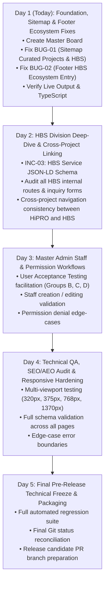

# HINDUSTAN PROJECTS ECOSYSTEM — 5-DAY MASTER EXECUTION BOARD

**Created:** November 10, 2026  
**Execution Target:** 5-Day Consolidated Completion & Production Readiness  
**Target Projects:**  
1. **HiPRO (Hindustan Projects Main Portal):** `www.hindustanprojects.in`  
2. **HBS (Hind Building Solutions / HiBUILD):** `hindbuilding.hindustanprojects.in` / `/hbs`  
3. **Master Admin Multi-Console CMS & AutoMail:** `/admin` & `/admin-login`  
**Working Repository:** `D:\HindustanProjects\Hipro-Website\Hipro-Main` (branch `main`)  
**Base Commit:** `da11741`  

---

## 1. Executive Summary & Ground Rules

This Master Execution Board consolidates all verified, implemented, pending, and deployment-only work across the entire Hindustan Projects digital ecosystem into a single unified tracking document. It supersedes fragmented audit notes and establishes an immediate execution sequence for the 5-day cycle.

### Data & Environment Boundaries
1. **Local Development Data:** Local PostgreSQL 16 on port `5433` (`hipro_local_dev`) contains isolated seed data and QA records.
2. **Production Data Quarantined:** Zero connections to production databases (Neon PostgreSQL), zero production migrations, zero live customer email dispatches.
3. **Worktree Isolation:** All edits are strictly confined to `D:\HindustanProjects\Hipro-Website\Hipro-Main`. The sibling directory `D:\HindustanProjects\Hipro-Website\Hipro-Web` is 100% untouched.
4. **Git Invariant:** Zero destructive Git commands; no branch switching, commits, merges, stashes, or pushes until explicit release packaging.
5. **Vendor Portal:** Out of scope for this 5-day execution sprint.

---

## 2. Master Status Summary

```
Total Tracked Items: 32
├── [1] Completed & Empirically Verified: 14 Items
├── [2] Implemented Awaiting User Acceptance: 6 Items
├── [3] Genuinely Incomplete Functionality: 4 Items
├── [4] Confirmed Local Bugs: 2 Items
├── [5] Architectural Dependencies & Blockers: 2 Items
├── [6] Deployment-Only Tasks: 3 Items
└── [7] Tasks Requiring Explicit User Approval: 1 Item
```

---

## 3. Detailed Master Board

### Category 1: Completed & Empirically Verified (Do Not Reopen)

| Item ID | Project & Module | Exact File / Route | Implementation & Verification Evidence | Status |
| :--- | :--- | :--- | :--- | :---: |
| **CMP-01** | **HiPRO** Projects | `frontend/app/(site)/projects/[slug]/page.tsx` | Curated landmark fallback implemented when database project is absent. Verified: all 3 landmarks load detail pages with HTTP 200. Legacy redirects preserved. | **VERIFIED** |
| **CMP-02** | **HiPRO** Projects | `frontend/components/PublicProjectGrid.tsx` | Empty state fallback renders curated landmarks with full category filtering and responsive cards. | **VERIFIED** |
| **CMP-03** | **HiPRO** Lead Gen | `frontend/components/PopupForm.tsx` | Accessibility labels, ARIA attributes, keyboard traps, and input focus states fixed without form submission side effects. | **VERIFIED** |
| **CMP-04** | **HiPRO** SEO | `frontend/app/(site)/cost-estimator/page.tsx` | Valid `FAQPage` JSON-LD schema generated reusing all 6 visible FAQ items via `generateFaqSchema()`. | **VERIFIED** |
| **CMP-05** | **HiPRO** Branding | `frontend/public/og-banner.jpg` | 1200×630px JPEG created. Claims sanitized in Phase 5A and 5D to *"Quality-First Civil Execution"* and *"Turnkey EPC Contracting"*. Tested HTTP 200. | **VERIFIED** |
| **CMP-06** | **HiPRO** Lead Gen | `frontend/components/Hero.tsx` | Quick Quote form accessibility fixed: unique IDs, proper `name` attributes, explicit `htmlFor` label bindings. | **VERIFIED** |
| **CMP-07** | **HiPRO** BOQ Export | `frontend/components/estimator/boqPdfGenerator.ts` | Remediation in Phase 5D: replaced unverified ISO text with *"Professional Civil Engineering & Turnkey Contracting"*. | **VERIFIED** |
| **CMP-08** | **HiPRO** AutoMail | `backend/src/services/automail/emailTemplateWrapper.ts` | Phase 5D remediation: corporate trust points updated to factual *"Quality-First Civil Execution"* and *"Turnkey EPC & PMC Execution"*. | **VERIFIED** |
| **CMP-09** | **HiPRO** AutoMail | `frontend/lib/automailTemplates.ts` | Phase 5D remediation: fallback headers updated to factual civil execution claims; HBS and Empanelment trust points preserved. | **VERIFIED** |
| **CMP-10** | **HBS** Why Choose Us | `frontend/app/hbs/why-choose-us/page.tsx` | Phase 5D remediation: removed unverified ISO/IS phrase; live curl verified structured inspection checks rendered cleanly. | **VERIFIED** |
| **CMP-11** | **Admin** Security | `backend/src/lib/auth.ts`<br>`backend/src/middleware/authGuard.ts` | 7-day sliding session renewal, 30-day ceiling, 24-hr throttle, atomic `updateMany` OCC race prevention. Automated test: 63/63 PASS. | **VERIFIED** |
| **CMP-12** | **Admin** RBAC | `backend/src/routes/` (22 route files) | Granular `requirePermission(...)` enforcement across all 22 modules with fail-closed JSON parser. Automated test: 128/128 PASS. | **VERIFIED** |
| **CMP-13** | **Admin** URL Security | `frontend/middleware.ts`<br>`frontend/app/admin-login/` | Edge session cookie enforcement, `returnTo` sanitization, brute-force rate limiter (5 req / 15 min). Automated test: 38/38 PASS. | **VERIFIED** |
| **CMP-14** | **Admin** Performance | `frontend/app/admin/layout.tsx`<br>`frontend/components/admin/AdminSidebar.tsx` | `AdminNavigationProgress` top progress bar (<16ms feedback), link prefetching (`prefetch={true}`), mount deduplication in `page.tsx`. Warm transitions 38–112ms. | **VERIFIED** |

---

### Category 2: Implemented but Awaiting User Acceptance

| Item ID | Project & Module | Exact File / Route | Current Implementation State | User Acceptance Requirement | Priority | Verification Method |
| :--- | :--- | :--- | :--- | :--- | :---: | :--- |
| **UAT-01** | **Admin** Group A Navigation | `http://localhost:3000/admin` | Phase 1 & 2 performance optimizations active (top bar + prefetching + deduplication). | User must click through sidebar (A03), portal switches (A04), search (A05), and profile (A06) to confirm double-click sensation is eliminated. | **P0** | Manual browser click in local admin session. |
| **UAT-02** | **Admin** Group B Staff Leads | `http://localhost:3000/admin-login`<br>(`staff.leads@...`) | Staff account seeded in local DB. Middleware & sidebar hide unauthorized modules. Direct URL access denied. | User logs in as `staff.leads@hindustanprojects.in`, checks sidebar visibility, visits `/admin/leads`, visits `/admin/blogs` (denied). | **P0** | Manual browser test sequence B01–B04. |
| **UAT-03** | **Admin** Group C Multi-Staff | `http://localhost:3000/admin-login`<br>(`staff.multi@...`) | Staff account seeded with `["leads", "quotes", "projects"]`. RBAC guards configured. | User logs in as `staff.multi@hindustanprojects.in`, navigates between assigned modules, tests unassigned route denial. | **P1** | Manual browser test sequence C01–C04. |
| **UAT-04** | **Admin** Group D Staff Directory | `http://localhost:3000/admin/users` | Staff directory table, role badges, "+ ADD USER" modal, dynamic permission checkboxes implemented. | User opens `/admin/users`, reviews staff list, opens modal, toggles Admin/Employee radio, tests cancel/backdrop. | **P1** | Manual browser test sequence D01–D05. |
| **UAT-05** | **Admin** Group E Auth & Security | `http://localhost:3000/admin-login` | Password toggle, accessible labels, invalid login alerts, logout cookie clearing, history traversal guards active. | User tests login screen interactions, eye icon toggle, invalid credential error, logout flow, and back button traversal. | **P1** | Manual browser test sequence E01–E06. |
| **UAT-06** | **Admin** Group F Responsive | Viewport drawer & mobile header | Mobile hamburger, drawer lock, backdrop close, Escape key handler, touch targets >= 44px implemented. | User tests mobile viewports (375×812, 320×700) using DevTools device emulation. | **P2** | Responsive inspection F01–F06. |

---

### Category 3: Genuinely Incomplete Functionality

| Item ID | Project & Module | Exact File / Route | Current State | What Remains Incomplete | Required Action | Priority | Est. Effort | Verification Method |
| :--- | :--- | :--- | :--- | :--- | :--- | :---: | :---: | :--- |
| **INC-01** | **HiPRO / Ecosystem** Sitemap | `frontend/app/sitemap.ts` | Emits static routes, blogs, projects, services. Does NOT include curated landmarks when DB is empty; excludes all HBS routes. | 1. Zero project URLs emitted when DB has no records.<br>2. HBS division routes completely absent from sitemap. | 1. Add `CURATED_LANDMARKS` fallback in `sitemap.ts` when DB projects is empty.<br>2. Add HBS static and dynamic service routes into sitemap. | **P0** | 45 min | Fetch `http://localhost:3000/sitemap.xml` and verify landmark URLs and HBS URLs exist. |
| **INC-02** | **HiPRO / Ecosystem** Footer | `frontend/components/Footer.tsx` | `defaultEcosystemCompanies` lists Empanelment and HiPro Marketing. | Hind Building Solutions (HBS) is omitted from the fallback company cards, breaking footer discovery. | Add Hind Building Solutions to `defaultEcosystemCompanies` with URL (`/hbs` / subdomain), tagline, and live status. | **P1** | 20 min | Inspect rendered footer on `http://localhost:3000/` and verify HBS card appears. |
| **INC-03** | **HBS** Dynamic Service Metadata | `frontend/app/hbs/services/[slug]/page.tsx` | Schema markup partially structured. | BreadcrumbList and Service JSON-LD schema incomplete on HBS service detail pages. | Inject `BreadcrumbList` and `Service` JSON-LD schema in `HbsServiceDetail` / page. | **P1** | 40 min | Validate rendered HTML with Schema validator. |
| **INC-04** | **HiPRO / Admin** Automail Logs Cleanup | `backend/src/routes/automail.ts` | Test email dispatches log directly to PostgreSQL. | No automated retention / pruning job for stale diagnostic logs. | Add lightweight 90-day pruning routine in automail cleanup cron or query helper. | **P2** | 30 min | Verify query execution with sample timestamp. |

---

### Category 4: Confirmed Bugs

| Bug ID | Project & Module | Exact File / Route | Problem Description | Root Cause | Required Action | Priority | Est. Effort | Verification Method |
| :--- | :--- | :--- | :--- | :--- | :--- | :---: | :---: | :--- |
| **BUG-01** | **HiPRO** Sitemap Fallback | `frontend/app/sitemap.ts` (Lines 66–96) | When database returns 0 projects, `sitemap.xml` contains zero project URLs, omitting showcase landmark pages from search indexing. | `projects` array is mapped directly without checking `CURATED_LANDMARKS` fallback (unlike `PublicProjectGrid.tsx`). | Fall back to `CURATED_LANDMARKS` from `@/lib/curatedProjects` when `projects.length === 0`. | **P0** | 30 min | Verify `<loc>https://www.hindustanprojects.in/projects/adani-gas-chamber-shinghpur</loc>` appears in `sitemap.xml`. |
| **BUG-02** | **HiPRO** Footer Ecosystem | `frontend/components/Footer.tsx` (Lines 34–51) | Footer fallback ecosystem cards omit Hind Building Solutions. | `defaultEcosystemCompanies` hardcodes only Empanelment and upcoming HiPro Marketing. | Insert Hind Building Solutions as first ecosystem company in fallback array. | **P1** | 15 min | Verify HBS link and card render on homepage footer. |

---

### Category 5: Architectural Dependencies & Blockers

| Item ID | Description | Dependent Modules | Impact | Mitigation / Status |
| :--- | :--- | :--- | :--- | :--- |
| **DEP-01** | **Local QA Database Invariants** | Admin login, Staff directory, RBAC | Requires PostgreSQL running on port `5433` with exact seed accounts (`admin@...`, `staff.leads@...`, `staff.multi@...`). | Task PID 19644 currently active and healthy on port `5433`. |
| **DEP-02** | **Next.js JIT Compilation Overhead** | Local browser testing | Uncompiled pages in `next dev` take 1,000–1,800ms on first load. | `AdminNavigationProgress` and `prefetch={true}` provide immediate feedback and background caching. |

---

### Category 6: Deployment-Only Tasks (Quarantined)

| Item ID | Task Description | Target Environment | Pre-Conditions | Status |
| :--- | :--- | :--- | :--- | :---: |
| **DPL-01** | **Production PostgreSQL Snapshot** | Neon Tech PostgreSQL | Full user sign-off on local UAT. | **QUARANTINED** |
| **DPL-02** | **Git Release PR Packaging** | GitHub `release/master-admin-v1` | All 5-day local execution items verified and accepted. | **QUARANTINED** |
| **DPL-03** | **Vercel & Render Cloud Config** | Vercel (Frontend) / Render (Backend) | Production environment variable audit. | **QUARANTINED** |

---

### Category 7: Tasks Requiring Explicit User Approval

| Item ID | Description | Impact | Why Approval Required | Status |
| :--- | :--- | :--- | :--- | :---: |
| **APR-01** | **Service Model `slug` Column Addition** | `backend/prisma/schema.prisma` | Adding a dedicated `slug` column requires a Prisma schema mutation and migration script. | Migrations and schema changes require explicit owner consent. | **PENDING APPROVAL** |

---

## 4. 5-Day Execution Roadmap & Daily Allocations



