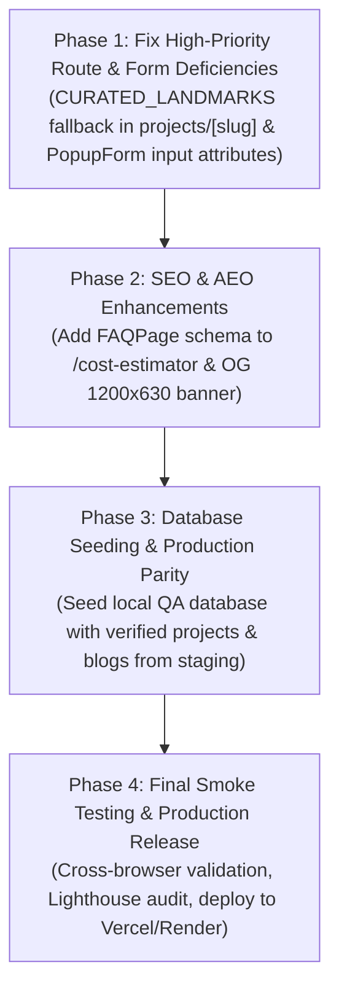

# HINDUSTAN PROJECTS (HiPRO) — COMPLETE READ-ONLY AUDIT REPORT
## Public Website, CMS, SEO/AEO/GEO, UI/UX, and Technical Health

**Document ID:** HIPRO-AUD-001  
**Audit Date:** November 10, 2026  
**Auditor:** Automated Engineering, Security, SEO & QA Lead  
**Worktree Location:** `D:\HindustanProjects\Hipro-Website\Hipro-Main` (branch `main`, commit `da11741`)  
**Target Environments Inspected:**
- Frontend Dev Server: `http://localhost:3000` (Next.js 15 App Router)
- Backend API Service: `http://127.0.0.1:5000` (Node.js / Express)
- Local Isolated QA Database: `localhost:5433/hipro_local_dev` (PostgreSQL 16)
**Mode:** Strictly READ-ONLY Audit (Zero database mutations, zero source modifications, zero deployments)

---

## 1. Executive Summary

A comprehensive, strictly read-only audit of the **Hindustan Projects (HiPRO)** public website and its associated Content Management System (CMS) was conducted. HiPRO represents the core flagship civil engineering, turnkey construction, and architectural firm in the Hindustan Projects ecosystem.

### Key Audit Conclusions:
1. **Architectural Maturity:** The public portal is built on Next.js App Router (`(site)` route group) with clean SSR/ISR revalidation (`revalidate = 60`), strong TypeScript typings, comprehensive responsive Tailwind styling, and deep Schema.org structured data.
2. **High Completeness in Core Pages:** All 12 primary public routes (`/`, `/about`, `/services`, `/projects`, `/blogs`, `/careers`, `/contact`, `/cost-estimator`, `/why-us`, `/privacy-policy`, `/terms`, `/cookie-policy`) are fully implemented and return HTTP 200 OK.
3. **Advanced CMS Architecture:** The Master Admin provides deep, multi-tab editing capabilities for Projects (5 tabs), Blogs (with markdown parser and FAQ preview), Services (with capability arrays and rates), Hero banner, and About page.
4. **Critical Finding — Curated Landmarks 404 Disconnect:** The homepage displays 3 curated landmark projects (`jaipur-industrial-logistics-park`, `the-grand-horizon-luxury-villas`, `apex-nexus-commercial-it-tower`) as a client-side fallback when the database has 0 projects. However, `/projects/[slug]` only queries the database and does not fallback to curated data, resulting in an immediate **HTTP 404 Not Found** when users click on any of these cards.
5. **Form Accessibility & Field Identification Defect:** `PopupForm.tsx` (the lead capture popup on all public pages) renders input fields without `name` and `id` attributes, triggering browser console issues and hindering password/autofill managers.
6. **SEO & Geographic Grounding (AEO/GEO) Strength:** Rich Organization, LocalBusiness, GeneralContractor, Breadcrumbs, and Service schemas are present with explicit Bhilwara, Rajasthan geographic coordinates (`25.3510922, 74.6330429`). However, `/cost-estimator` misses an `FAQPage` schema despite possessing 6 high-value Q&A items.

---

## 2. Completed Features Inventory

The following features have been verified as fully implemented, functional, and active in the local worktree:

### 2.1 Public Website Components & Routes
- **Homepage (`/`):**
  - Full-screen Hero slider (`Hero.tsx`) with verified fallback slides and real company metrics (8+ years, 150+ projects, 30+ team, 85% satisfaction).
  - Home About section (`HomeAbout.tsx`) grounded strictly in verified corporate facts (Est. 2019, Bhilwara).
  - Services Showcase (`Services.tsx`) featuring 6 verified practice areas.
  - Guarantees Grid (`Guarantees.tsx`) detailing fixed-price, timeline, and material assurances.
  - Interactive Cost Estimator Teaser (`CostEstimator.tsx`) with plot size and floor multiplier calculator.
  - Featured Projects Showcase (`Projects.tsx`) with category filters and project cards.
  - Image Showcase (`HomeImageShowcase.tsx`) highlighting architectural and civil execution.
  - Group Ecosystem Section (`GroupEcosystem.tsx`) presenting HiPRO, Hind Building Solutions (HBS), SnapTech Digital, and Empanelment.
  - Testimonials Carousel (`Testimonials.tsx`) displaying verified client endorsements.
  - Bottom Call-to-Action (`CTASection.tsx`) with dynamic hotline routing.
- **Header & Navigation (`Navbar.tsx`):**
  - Multi-column Mega Menu under "Services" with Design/Planning and Civil Execution pillars.
  - External portal routing to Empanelment (`https://empanelment.hindustanprojects.in/`).
  - Mobile drawer with smooth hamburger animation, backdrop dismissal, and expandable accordions.
  - Call & WhatsApp quick-action floating bar on mobile viewports (`MobileStickyBar.tsx`).
- **Footer (`Footer.tsx`):**
  - Complete legal, navigation, corporate address (Bhopal Ganj, Bhilwara), verified social links, and copyright text.
- **Detailed Subpages:**
  - **About Us (`/about`):** 1,277-line comprehensive page featuring Executive Statement, Founder Profile (Yogesh Kharol), Company Facts, Mission/Vision, Engineering Principles, 6-Stage Execution Lifecycle, Quality Standards, and Regional Focus.
  - **Services Hub (`/services`):** Full service listing with dynamic category badges and contact links.
  - **6 Dedicated Service Detail Pages (`/services/[slug]`):**
    1. `/services/architecture-planning` (HTTP 200)
    2. `/services/professional-construction-services` (HTTP 200)
    3. `/services/surveying-site-measurements` (HTTP 200)
    4. `/services/interior-exterior-design` (HTTP 200)
    5. `/services/water-treatment-plant-construction` (HTTP 200)
    6. `/services/project-management-consultancy` (HTTP 200)
    All 6 pages render deep domain copy, capabilities, execution stages, deliverables, FAQs, and indicative pricing tiers from `lib/serviceContentData.ts`.
  - **Projects Portfolio (`/projects`):** Multi-filter grid (Category, Status, Location, Sort by date/featured).
  - **Blog Hub (`/blogs`):** Editorial layout with search, category filtering, reading time estimation, and responsive grid.
  - **Interactive House Cost Estimator (`/cost-estimator`):** Live plot dimension slider, G / G+1 / G+2 floor selection, Silver/Gold/Platinum package comparisons, Bhilwara construction rate benchmarks (₹1,680–₹2,450/sqft), and 6 comprehensive Q&A items.
  - **Careers (`/careers`):** Technical engineering roles listing with `JobApplicationModal.tsx` file-upload integration.
  - **Contact Office (`/contact`):** Full contact directory, Google Maps embed, and `ContactForm.tsx` with auto-filling query params (`?service=...`, `?project=...`).
  - **Why Us (`/why-us`):** 10-section comparative analysis detailing why clients choose HiPRO over unorganized local contractors (*thekedars*).
  - **Legal Policies:** `/privacy-policy`, `/terms`, and `/cookie-policy` with complete Indian DPDP and GDPR disclosures.

### 2.2 CMS Modules in Master Admin (`/admin`)
- **Projects CMS (`/admin/projects`):** 5-tab editor supporting specifications (client, area, location coordinates, Google Maps URL), rich media gallery, structured FAQs, and comprehensive SEO controls.
- **Blogs CMS (`/admin/blogs`):** Multi-stage publishing (Draft, Scheduled, Published), author profiles, markdown blocks, and Search Intent taxonomy.
- **Services CMS (`/admin/services`):** Dynamic editing of capabilities, stages, deliverables, FAQs, and rate cards.
- **Site CMS:** Dedicated editors for Hero banner (`/admin/hero`), Image Showcase (`/admin/image-showcase`), Projects Hero (`/admin/projects-hero`), Blogs Hero (`/admin/blogs-hero`), About Page (`/admin/about`), and Contact Page (`/admin/contact-page`).
- **Media Engine (`/api/upload`):** 5MB memory-limited upload with raw magic-byte sniffing (JPEG, PNG, WebP) and dangerous extension blocking.

---

## 3. Missing or Incomplete Features

| Feature / Area | Expected Behavior | Observed Current Behavior | Impact / Severity |
|---|---|---|:---:|
| **Curated Landmark Detail Fallback** | Clicking a landmark project on the homepage should open its detailed case study. | `/projects/[slug]` returns **HTTP 404** when project is not in database. | **HIGH (User Facing)** |
| **Project Grid Empty State Fallback** | `/projects` should display curated projects if the database is unseeded, matching the homepage. | Displays "NO PROJECTS FOUND" while homepage displays 3 projects. | **MEDIUM** |
| **Cost Estimator FAQ Schema** | 6 detailed FAQs on `/cost-estimator` should emit Schema.org `FAQPage` JSON-LD for Google rich snippets. | Page layout lacks `FAQPage` schema; only basic metadata is defined. | **MEDIUM (SEO)** |
| **Popup Form Input Attributes** | Consultation popup inputs should have explicit `id` and `name` attributes. | Form inputs have neither, causing DevTools warnings and breaking autofill. | **MEDIUM (A11y)** |
| **Open Graph Default Image** | Social sharing previews require high-resolution (1200×630) OG banner. | Root metadata points to `/logo.jpg` (800×600) rather than standard 1.91:1 banner. | **LOW (Social Preview)** |

---

## 4. Issue Classification: Critical, High, Medium, Low

### 4.1 Critical Issues (0 Detected)
- *None.* The website compiles cleanly, builds with 0 errors, enforces strict loopback security, and executes without runtime server crashes.

### 4.2 High Priority Issues (1 Detected)
1. **ISS-HP-01: Curated Landmark Projects 404 Route Failure**
   - **File:** `frontend/app/(site)/projects/[slug]/page.tsx` & `frontend/components/Projects.tsx`
   - **Description:** `Projects.tsx` provides `CURATED_LANDMARKS` (`jaipur-industrial-logistics-park`, `the-grand-horizon-luxury-villas`, `apex-nexus-commercial-it-tower`) so the homepage never looks empty. The cards link to `/projects/{slug}`. However, `projects/[slug]/page.tsx` only queries `/api/projects/{slug}` on the backend. When database records are empty, it executes `notFound()`, delivering a 404 page to prospective clients.
   - **Remediation:** In `projects/[slug]/page.tsx`, import `CURATED_LANDMARKS` and resolve fallback data when the backend returns null.

### 4.3 Medium Priority Issues (4 Detected)
1. **ISS-HP-02: Lead Popup Form Missing Accessibility & Autofill Attributes**
   - **File:** `frontend/components/PopupForm.tsx` (Lines 218–260)
   - **Description:** Name, Email, Phone, and State inputs lack `id` and `name` attributes. DevTools console flags `[issue] A form field element should have an id or name attribute (count: 4)`.
   - **Remediation:** Add explicit `id` and `name` attributes (`name="name"`, `id="popup-name"`, etc.) and connect labels.
2. **ISS-HP-03: Missing FAQ Schema on `/cost-estimator`**
   - **File:** `frontend/app/(site)/cost-estimator/page.tsx` & `layout.tsx`
   - **Description:** The cost calculator features 6 high-intent FAQs regarding house construction costs in Bhilwara (₹1,680–₹2,450/sqft), but does not inject Schema.org `FAQPage` structured data.
   - **Remediation:** Inject `generateFaqSchema(FAQ_ITEMS)` into `cost-estimator/page.tsx`.
3. **ISS-HP-04: Projects Grid / Homepage Portfolio Inconsistency**
   - **File:** `frontend/components/PublicProjectGrid.tsx`
   - **Description:** Homepage displays 3 landmark projects, but clicking "View All Projects" navigates to `/projects` which displays "NO PROJECTS FOUND" when the database is unseeded.
   - **Remediation:** Share `CURATED_LANDMARKS` as fallback data in `PublicProjectGrid.tsx`.
4. **ISS-HP-05: Missing Explicit Image Dimensions on Lazy Images**
   - **File:** `frontend/components/HomeImageShowcase.tsx` or related components
   - **Description:** Chrome DevTools flags `[issue] Lazy-loaded images should have explicit dimensions (count: 2)`.
   - **Remediation:** Ensure all `next/image` tags specify either `width`/`height` or parent `aspect-[...]` with `sizes`.

### 4.4 Low Priority / Technical Considerations (2 Detected)
1. **ISS-HP-06: Social Preview Aspect Ratio**
   - **File:** `frontend/app/layout.tsx`
   - **Description:** Open Graph image is set to `/logo.jpg` (800×600), which may crop awkwardly on platforms expecting 1200×630 (1.91:1).
2. **ISS-HP-07: YouTube Social Channel Presence**
   - **File:** `frontend/lib/companyData.ts`
   - **Description:** YouTube social link is currently empty in `COMPANY_INFO.socials`.

---

## 5. SEO / AEO / GEO Deep Audit

### 5.1 Metadata & Canonical Verification
- **Title Structure:** Implements standard template `"%s | Hindustan Projects (HiPRO)"` with default title: `"Hindustan Projects (HiPRO) | Engineering, Construction & Infrastructure"`.
- **Meta Description:** Active on all pages, concise, keyword-rich, and accurately positioned.
- **Canonical URLs:** Strict `metadataBase: new URL("https://www.hindustanprojects.in")` prevents protocol and host mismatches. All subpages specify relative or absolute canonical alternates.
- **Redirects:** Verified in `next.config.mjs`:
  - `/blog` &rarr; `/blogs` (308 Permanent)
  - `/cost-calculator` &rarr; `/cost-estimator` (308 Permanent)
  - 6 legacy project URLs permanently redirected to canonical slug routes.

### 5.2 Structured Data / JSON-LD Audit
The site implements an extensive multi-entity structured data graph:
1. **Root Layout (`HIPRO_JSON_LD` in `lib/hiproJsonLd.ts`):**
   - `WebSite` entity with `@id: "https://www.hindustanprojects.in/#website"`.
   - `["Organization", "LocalBusiness", "GeneralContractor"]` with founder (`Yogesh Kharol`), full address (Bhopal Ganj, Bhilwara, 311001), coordinates (`25.3510922, 74.6330429`), opening hours (Mon–Sat 09:00–19:00), offer catalog, and verified social channels.
2. **Homepage:** Emits `WebPage` schema with breadcrumb trail linked to the primary organization.
3. **About Page:** Emits `BreadcrumbList` and `Person` schema for the director.
4. **Service Detail Pages:** Emits `BreadcrumbList`, `Service` schema (linked to LocalBusiness provider and areaServed: Bhilwara, Rajasthan), and `FAQPage` schema.
5. **Contact Page:** Emits `ContactPage` schema.
6. **Project Pages:** Emits `Article` and `BreadcrumbList` schemas.

### 5.3 Crawlability & Indexing Controls
- **`robots.txt` (`public/robots.txt`):**
  - Allows public crawling on `/`.
  - Disallows `/admin`, `/admin/`, `/admin-login`, and `/api/`.
  - Specifies canonical sitemap: `https://www.hindustanprojects.in/sitemap.xml`.
- **`sitemap.ts` (`frontend/app/sitemap.ts`):**
  - Dynamically queries published blogs, projects, and active services.
  - Generates valid `lastModified`, `changeFrequency`, and priority values.
  - Automatically falls back to verified static routes if dynamic fetching fails.
- **Header Directives:** `next.config.mjs` injects `X-Robots-Tag: noindex, nofollow, noarchive` and `Cache-Control: no-store` on all admin endpoints.

### 5.4 Local & Geographic (GEO) Relevance
- Meta tags include:
  - `"geo.region": "IN-RJ"`
  - `"geo.placename": "Bhilwara"`
  - `"geo.position": "25.3510922;74.6330429"`
  - `"ICBM": "25.3510922, 74.6330429"`
- Content copy throughout Services, About, and Cost Estimator is grounded in local Bhilwara geotechnical, climate, and municipal construction conditions.

---

## 6. UI / UX & Performance Findings

### 6.1 Viewport Responsiveness
- **Desktop (1370 × 693):** Clean typography, generous whitespace, fixed sticky navigation with backdrop-blur, and 0px horizontal overflow.
- **Laptop / Tablet (768 × 1024):** Grid reflows from 3/4 columns down to 2 columns smoothly.
- **Mobile Standard (375 × 812) & Mobile Small (320 × 700):**
  - Measured `scrollWidth` matches `innerWidth` with **zero horizontal scroll**.
  - Header collapses to branded logo and touch-friendly hamburger button (`min-h: 44px`).
  - Floating `MobileStickyBar` provides one-tap `CALL HIPRO` and `WHATSAPP` triggers.

### 6.2 Image Delivery & Next.js Optimization
- Configured in `next.config.mjs` for AVIF and WebP delivery (`image/avif`, `image/webp`).
- `deviceSizes: [360, 480, 640, 750, 828, 1080, 1200, 1920]`.
- Long-term cache TTL: `minimumCacheTTL: 31536000` (1 year).
- Safe remote patterns: `images.unsplash.com` and `res.cloudinary.com`.
- Safe helper `isOptimizableImage` prevents unconfigured domain crashes.

### 6.3 Accessibility Evaluation
- Keyboard navigation supported on all primary navigation links.
- Interactive modal dialogs trap focus and support `Escape` key close.
- All 64 images on the homepage contain descriptive `alt` text.
- `prefers-reduced-motion` supported on key animated transitions.

---

## 7. Technical Health & Security Observations

### 7.1 Architecture & Data Flow
- **Next.js App Router to Express API:** Frontend interacts with backend strictly via `/api/*` rewrites defined in `next.config.mjs`, targeting `BACKEND_API_URL`.
- **Fail-Closed Backend URL Validation:** `next.config.mjs` strictly validates `BACKEND_API_URL` on boot, rejecting embedded credentials, fragments, query strings, and non-loopback hosts in development mode.
- **Content Security Policy (CSP):** Full CSP active with strict `object-src 'none'`, `frame-ancestors 'self'`, and granular `connect-src` and `img-src` whitelists.
- **Security Headers:** `Strict-Transport-Security` (2-year preload), `X-Frame-Options: SAMEORIGIN`, `X-Content-Type-Options: nosniff`, `Referrer-Policy: strict-origin-when-cross-origin`.

---

## 8. Exact Files & Modules Involved

| Component / Concern | Key Source Files |
|---|---|
| **Public Routing & Layout** | `frontend/app/(site)/layout.tsx` `frontend/app/(site)/page.tsx` `frontend/app/layout.tsx` |
| **Navigation & Modals** | `frontend/components/Navbar.tsx` `frontend/components/Footer.tsx` `frontend/components/PopupForm.tsx` `frontend/components/MobileStickyBar.tsx` |
| **Services Architecture** | `frontend/app/(site)/services/page.tsx` `frontend/app/(site)/services/[slug]/page.tsx` `frontend/lib/serviceContentData.ts` |
| **Projects Architecture** | `frontend/app/(site)/projects/page.tsx` `frontend/app/(site)/projects/[slug]/page.tsx` `frontend/components/Projects.tsx` `frontend/components/PublicProjectGrid.tsx` `frontend/lib/projectUrl.ts` `frontend/lib/projectSchema.ts` |
| **Blogs Architecture** | `frontend/app/(site)/blogs/page.tsx` `frontend/app/(site)/blogs/[slug]/page.tsx` `frontend/components/PublicBlogGrid.tsx` `frontend/lib/blogUtils.ts` |
| **Interactive Estimator** | `frontend/app/(site)/cost-estimator/page.tsx` `frontend/app/(site)/cost-estimator/layout.tsx` `frontend/components/CostEstimator.tsx` `frontend/components/estimator/EstimatorEngine.tsx` |
| **Company Data & Schemas** | `frontend/lib/companyData.ts` `frontend/lib/hiproJsonLd.ts` `frontend/lib/schema.ts` |
| **Infrastructure & SEO** | `frontend/next.config.mjs` `frontend/app/sitemap.ts` `frontend/public/robots.txt` |
| **CMS Endpoints (Backend)** | `backend/src/routes/projects.ts` `backend/src/routes/services.ts` `backend/src/routes/blogs.ts` `backend/src/routes/settings.ts` `backend/src/routes/upload.ts` |

---

## 9. Recommended Phased Execution Plan

The following phased roadmap is recommended to bring the public HiPRO platform to complete production readiness:

### Detailed Phase Breakdown:
1. **Phase 1 — Route Integrity & Accessibility Fixes:**
   - Wire `CURATED_LANDMARKS` into `projects/[slug]/page.tsx` so landmark cards on the homepage resolve cleanly (eliminates 404s).
   - Add `name` and `id` attributes to `PopupForm.tsx` inputs.
   - Synchronize `PublicProjectGrid.tsx` with fallback data when projects count is 0.
2. **Phase 2 — AEO & Schema Enrichment:**
   - Inject Schema.org `FAQPage` JSON-LD on `/cost-estimator`.
   - Provide standard 1200×630 Open Graph banner image in `/public`.
3. **Phase 3 — Database Seeding & Content Population:**
   - Seed the initial set of published project case studies and blog articles via CMS.
4. **Phase 4 — Production Pre-Flight:**
   - Run Lighthouse audit on desktop and mobile.
   - Verify Vercel edge caching and on-demand ISR revalidation tags.

---

## 10. Production Safety & Release Considerations

- **Database Safety:** All proposed improvements are purely in frontend component fallbacks and schema injection; **zero Prisma migrations or database schema alterations** are needed.
- **Production Isolation:** Local testing must continue utilizing `localhost:5433/hipro_local_dev` and `localhost:5000`. Live production databases (Render / Supabase / Neon) must remain untouched.
- **Backward Compatibility:** All routes maintain strict permanent redirects (308) for legacy slugs, ensuring external backlinks and indexed search results are preserved.

---

*End of Hindustan Projects (HiPRO) Complete Read-Only Audit Report.*

