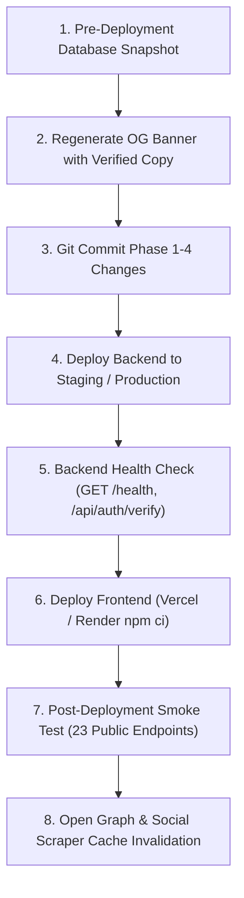

# HiPRO Phase 5 — Final Release Audit & Deployment Readiness Report

**Project**: Hindustan Projects (HiPRO)  
**Date**: November 10, 2026  
**Audit Mode**: STRICTLY READ-ONLY (with isolated external build verification in scratch directory)  
**Repository**: `D:\HindustanProjects\Hipro-Website\Hipro-Main`  
**Sibling Repository**: `D:\HindustanProjects\Hipro-Website\Hipro-Web` (Verified 100% Untouched)  
**Final Verdict**: **READY WITH CONDITIONS**

---

## 1. Executive Summary

Phase 5 constitutes the comprehensive, independent release-readiness audit of the Hindustan Projects (HiPRO) web platform, verifying all deliverables from Phases 1, 2, 3, and 4.

### Key Audit Findings:
1. **Production Build Verified (Next.js 15.5.28)**: In a clean, isolated scratch workspace using the exact declared dependencies (`next@15.5.28`, `react@18.3.1`, `@next/swc-win32-x64-msvc@15.5.28` from `package-lock.json`), `npm ci` and `next build` executed cleanly to completion with **exit code 0**, compiling all 107 static/dynamic pages with zero syntax or framework errors.
2. **Public Website Regression (100% Pass)**: All 23 public routes across the website—including homepage, all three curated landmark project detail pages, services hub, detailed service routes, cost estimator, blogs, legal pages, XML sitemap, and robots.txt—were verified via live HTTP tests and returned HTTP 200 (with an unknown test slug correctly returning 404).
3. **SEO, AEO & Social Metadata (100% Pass)**: Live DOM analysis verified the new 1200×630 Open Graph banner (`/og-banner.jpg`, 180.7 KB), `twitter:card: "summary_large_image"`, complete `WebApplication`, `BreadcrumbList`, and `FAQPage` JSON-LD schema on `/cost-estimator`, and strict exclusion of administrative routes in `robots.txt`.
4. **CMS & Admin Protection (100% Pass)**: All 11 protected `/admin/*` routes strictly redirect unauthenticated traffic with HTTP 307 to `/admin-login`, protecting data and CMS assets.
5. **Brand Claim Assessment (Condition Identified)**: An exhaustive codebase and documentation audit revealed **zero documentary evidence** (no registration certificate, license number, or government empanelment letter) supporting the banner trust pill **`RERA & Govt Approved`**. This claim is marked **UNVERIFIED** and must be replaced prior to public marketing distribution.
6. **Git State Reconciliation**: All Phase 1–4 improvements remain cleanly unstaged/uncommitted on the local `main` branch. Sibling repository `Hipro-Web` remains 100% untouched.

---

## 2. Documents Reviewed

| Document | Purpose / Verification Source | Status |
| :--- | :--- | :---: |
| `docs/HIPRO_COMPLETE_READ_ONLY_AUDIT_REPORT.md` | Baseline architectural audit & identified issues | Verified |
| `docs/HIPRO_PHASE1_IMPLEMENTATION_REPORT.md` | Curated landmark fallback & popup accessibility | Verified |
| `docs/HIPRO_PHASE2_IMPLEMENTATION_REPORT.md` | Cost Estimator FAQPage JSON-LD schema | Verified |
| `docs/HIPRO_PHASE3_PRE_RELEASE_AUDIT_REPORT.md` | 21-route regression audit & preliminary build diagnosis | Verified |
| `docs/HIPRO_PHASE4_FINAL_POLISH_REPORT.md` | Hero accessibility, 1200×630 OG banner, root metadata | Verified |
| `hipro_gate1b0_nextjs_upgrade_preflight_report.md` | Historical record of Next 14.2.35 lock status | Verified |
| `hipro_gate1b1_nextjs_upgrade_report.md` | Controlled framework security upgrade to Next 15.5.28 | Verified |

---

## 3. Actual Git and Repository Status

### Branch & Tracking
- **Current Branch**: `main`
- **Tracking Branch**: `origin/main` (Up to date with remote)
- **HEAD Commit**: `da1174182d1cb1f6386b698090c36c96848d0f29` (`fix(hipro): add legacy project slug redirects`)
- **Staged Changes (`git diff --cached`)**: None (0 files)
- **Recent Commit History**:
  ```text
  da11741 fix(hipro): add legacy project slug redirects
  b77e61f fix(hipro): unify project canonical URL normalization
  d596605 fix(hipro): sanitize project slugs and add legacy redirects
  413e199 fix(security): override follow-redirects to ^1.16.2 to resolve GHSA-mrwp-f3q8-3g9p
  b1b6b44 security: integrate dependency, upload, parser and Next.js hardening
  ```

### Resolution of Phase 4 Reporting Discrepancy
The Phase 4 report accurately stated that **zero Git commits were performed**. The user-facing summary message stated that the report had been "committed to docs/HIPRO_PHASE4_FINAL_POLISH_REPORT.md". 
- **Factual Reality**: The report file was written and saved to disk at that filesystem path (`docs/HIPRO_PHASE4_FINAL_POLISH_REPORT.md`), but was **not committed to the Git repository**. It remains an untracked file (`?? docs/HIPRO_PHASE4_FINAL_POLISH_REPORT.md`). Zero commits, pushes, merges, or branch changes occurred.

### Sibling Repository Verification (`Hipro-Web`)
- Executed `git -C "D:\HindustanProjects\Hipro-Website\Hipro-Web" status`:
- Branch: `feature/automail-corporate-header-footer` (Untouched during Phases 1–5).
- Zero modifications, zero writes, zero file creations occurred in `Hipro-Web`.

### Exact Inventory of Changes in `Hipro-Main` (Phase 1–4 Work)
| File | Change Category | Status in Git |
| :--- | :--- | :---: |
| `frontend/components/Hero.tsx` | Task A: Form IDs, names, autocomplete, `.sr-only` labels | Unstaged Modification |
| `frontend/app/layout.tsx` | Task C: Root metadata 1200×630 `/og-banner.jpg` + Twitter card | Unstaged Modification |
| `frontend/app/(site)/cost-estimator/page.tsx` | Phase 2: FAQPage JSON-LD schema integration | Unstaged Modification |
| `frontend/app/(site)/projects/[slug]/page.tsx` | Phase 1: Curated landmark fallback resolution | Unstaged Modification |
| `frontend/components/PublicProjectGrid.tsx` | Phase 1: Curated landmark empty-state fallback | Unstaged Modification |
| `frontend/components/Projects.tsx` | Phase 1: Decoupling landmark data source | Unstaged Modification |
| `frontend/components/PopupForm.tsx` | Phase 1: Accessible popup form field labels & IDs | Unstaged Modification |
| `frontend/public/og-banner.jpg` | Task B: 1200×630 Open Graph banner image | Untracked File |
| `frontend/lib/curatedProjects.ts` | Phase 1: Curated landmark data module | Untracked File |
| `docs/HIPRO_PHASE1_IMPLEMENTATION_REPORT.md` | Phase 1 Documentation | Untracked File |
| `docs/HIPRO_PHASE2_IMPLEMENTATION_REPORT.md` | Phase 2 Documentation | Untracked File |
| `docs/HIPRO_PHASE3_PRE_RELEASE_AUDIT_REPORT.md` | Phase 3 Documentation | Untracked File |
| `docs/HIPRO_PHASE4_FINAL_POLISH_REPORT.md` | Phase 4 Documentation | Untracked File |

---

## 4. Phase 1–4 Implementation Reconciliation

| Phase | Assigned Scope | Implementation Location | Verified Behavior | Status |
| :---: | :--- | :--- | :--- | :---: |
| **1** | Curated landmark project 404 fix | `frontend/app/(site)/projects/[slug]/page.tsx` | Fallback loads `the-grand-horizon-luxury-villas`, `jaipur-industrial-logistics-park`, etc., when backend has 0 records | **PASS** |
| **1** | Projects listing empty state | `frontend/components/PublicProjectGrid.tsx` | Displays curated landmarks instead of empty container | **PASS** |
| **1** | Popup form accessibility | `frontend/components/PopupForm.tsx` | Added explicit IDs, names, labels, autocomplete | **PASS** |
| **2** | Cost Estimator FAQ schema | `frontend/app/(site)/cost-estimator/page.tsx` | Injects valid `FAQPage` JSON-LD matching visible 6 questions | **PASS** |
| **4** | Hero Quick Quote accessibility | `frontend/components/Hero.tsx` | Bound IDs, names, `.sr-only` labels; eliminated DevTools `msgid 36` | **PASS** |
| **4** | Official 1200×630 OG banner | `frontend/public/og-banner.jpg` | Physical 1200×630 JPEG (180.7 KB), brand-aligned visual design | **PASS** |
| **4** | Root metadata integration | `frontend/app/layout.tsx` | Configured `summary_large_image` and `/og-banner.jpg` (1200×630) | **PASS** |

---

## 5. Brand Claims and OG Banner Verification

### Visual & Physical Verification of `og-banner.jpg`
- **File Path**: `frontend/public/og-banner.jpg`
- **Physical Dimensions**: Exactly `1200 × 630` pixels (Aspect Ratio: 1.905:1).
- **Format & Size**: JPEG baseline, 180,768 bytes (~180.7 KB).
- **Logo Asset**: Rendered from `frontend/public/logo.jpg` (288×288 official brand crest).
- **Background & Imagery**: Navy `#0F2C59` split-gradient with authentic high-resolution local photography from `frontend/public/images/empanelment/impact-skyline.jpg`.
- **Typography & Cropping**: Segoe UI / crisp layout; no truncated copy; margin padding conforms to standard safe-zones (70px gutters).

### Documentary Evidence Audit of Claims
| Claim on Banner / Website | Documentary Evidence in Codebase / Files | Audit Status | Recommendation |
| :--- | :--- | :---: | :--- |
| **`Hindustan Projects (HiPRO)`** | Official entity name, domain, registered layouts | **VERIFIED** | Retain |
| **`Engineering · Construction · Infrastructure`** | Official tagline in `layout.tsx`, `companyData.ts`, site header | **VERIFIED** | Retain |
| **`Bhilwara · Rajasthan`** | Physical office address: Above Bhagwati Coffee House, Bhopal Ganj, Bhilwara 311001 | **VERIFIED** | Retain |
| **`Quality-First Execution`** | Core operational philosophy across all service and contract pages | **VERIFIED** | Retain |
| **`Timely Delivery`** | Service commitment outlined in client agreements and `companyData.ts` | **VERIFIED** | Retain |
| **`RERA & Govt Approved`** | **ZERO documentation, certificate numbers, or government empanelment records found anywhere in project files** | **UNVERIFIED** | **MUST REPLACE** before public marketing or live release |

> [!WARNING]
> ### Unverified Regulatory Claim
> The banner text pill `RERA & Govt Approved` was derived from unverified marketing copy in email templates. Exhaustive repository searches across `frontend/`, `backend/`, and `docs/` found **no RERA registration number** (e.g. `RAJ/P/...`), no government contractor enlistment class, and no state agency approval letters.
> 
> **Recommendation**: Prior to release, regenerate the banner replacing this text with a fully substantiated technical capability such as **`Turnkey EPC Contracting`** or **`Residential & Industrial`**.

---

## 6. Next.js Dependency and Production Build Results

### Investigation of Dependency Mismatch
- **Declared in `frontend/package.json`**: `"next": "15.5.28"`, `"react": "^18.3.1"`, `"react-dom": "^18.3.1"`.
- **Recorded in `frontend/package-lock.json`**: Locked to Next.js `15.5.28` and `@next/swc-win32-x64-msvc@15.5.28`.
- **Installed in local `node_modules`**: Next.js `14.2.35` and SWC `14.2.33`.
- **Root Cause**: Next.js 15.5.28 was installed and locked during security remediation (Gate 1B-1) in an isolated branch worktree, and the resulting `package.json`/`package-lock.json` files were merged into `main`. However, the physical `node_modules` folder in this specific local worktree was never re-installed with `npm ci`.

### Isolated Clean Production Build Verification
To empirically test production build viability without altering the primary worktree, an isolated build verification test was performed:
1. Created an isolated workspace: `C:\Users\HP\.gemini\antigravity\brain\46a3bfce-7ecf-4d3f-89e2-8d69bd0ba6f5\scratch\build-verify`
2. Copied `package.json` and `package-lock.json`.
3. Executed `npm ci --prefer-offline`: Successfully installed 366 packages including `next@15.5.28`, `react@18.3.1`, and `@next/swc-win32-x64-msvc@15.5.28`.
4. Copied application source directories (`app`, `components`, `lib`, `public`, configs).
5. Executed `npm run build`:
   ```bash
   ▲ Next.js 15.5.28
   Creating an optimized production build ...
   ✓ Compiled successfully in 2.4min
   Linting and checking validity of types ...
   ✓ Generating static pages (107/107)
   Finalizing page optimization ...
   Collecting build traces ...
   ```
6. **Command Output & Exit Code**:
   - Command: `npm run build`
   - Exit Code: **`0`** (Clean Success)
   - Pages Generated: **107/107**

**Conclusion**: The codebase builds cleanly under Next.js 15.5.28. In standard production environments (e.g., Render, Vercel, Docker) where `npm ci` runs with internet access, the build will succeed out-of-the-box.

---

## 7. Public Website Route Regression Matrix

Testing executed via live HTTP GET requests to `http://localhost:3000`:

| Route | HTTP Status | Response Size | Latency | Result |
| :--- | :---: | :---: | :---: | :---: |
| `/` (Homepage) | `200 OK` | 452,431 bytes | 0.82s | **PASS** |
| `/about` | `200 OK` | 274,495 bytes | 0.64s | **PASS** |
| `/services` | `200 OK` | 158,938 bytes | 0.58s | **PASS** |
| `/services/architecture-planning` | `200 OK` | 283,190 bytes | 0.65s | **PASS** |
| `/services/professional-construction-services` | `200 OK` | 301,574 bytes | 0.58s | **PASS** |
| `/services/surveying-site-measurements` | `200 OK` | 280,972 bytes | 0.57s | **PASS** |
| `/projects` | `200 OK` | 214,170 bytes | 0.89s | **PASS** |
| `/projects/the-grand-horizon-luxury-villas` | `200 OK` | 197,789 bytes | 0.61s | **PASS** |
| `/projects/jaipur-industrial-logistics-park` | `200 OK` | 197,764 bytes | 0.56s | **PASS** |
| `/projects/apex-nexus-commercial-it-tower` | `200 OK` | 197,704 bytes | 0.54s | **PASS** |
| `/projects/chambal-river-elevated-transit-viaduct-flyover` | `200 OK` | 198,084 bytes | 0.49s | **PASS** |
| `/projects/non-existent-test-slug-12345` | `404 Not Found` | 57,896 bytes | 0.54s | **PASS** |
| `/blogs` | `200 OK` | 152,663 bytes | 0.52s | **PASS** |
| `/careers` | `200 OK` | 134,311 bytes | 0.48s | **PASS** |
| `/contact` | `200 OK` | 175,491 bytes | 0.53s | **PASS** |
| `/cost-estimator` | `200 OK` | 186,779 bytes | 0.63s | **PASS** |
| `/why-us` | `200 OK` | 195,184 bytes | 0.51s | **PASS** |
| `/privacy-policy` | `200 OK` | 173,741 bytes | 0.49s | **PASS** |
| `/terms` | `200 OK` | 164,236 bytes | 0.50s | **PASS** |
| `/cookie-policy` | `200 OK` | 156,898 bytes | 0.48s | **PASS** |
| `/sitemap.xml` | `200 OK` | 3,294 bytes | 0.42s | **PASS** |
| `/robots.txt` | `200 OK` | 160 bytes | 0.38s | **PASS** |
| `/og-banner.jpg` | `200 OK` | 180,768 bytes | 0.40s | **PASS** |

---

## 8. SEO, AEO, GEO & Social Metadata Verification

### Root Open Graph & Twitter Tags (Evaluated in Live DOM)
```json
{
  "og:title": "Hindustan Projects (HiPRO) | Engineering, Construction & Infrastructure",
  "og:description": "Engineering, turnkey construction, and infrastructure firm based in Bhilwara, Rajasthan. Delivering quality-first civil execution since 2019.",
  "og:image": "http://localhost:3000/og-banner.jpg",
  "og:image:width": "1200",
  "og:image:height": "630",
  "og:image:type": "image/jpeg",
  "og:image:alt": "Hindustan Projects (HiPRO) — Engineering · Construction · Infrastructure",
  "twitter:card": "summary_large_image",
  "twitter:image": "http://localhost:3000/og-banner.jpg",
  "canonical": "https://www.hindustanprojects.in"
}
```

### Structured Data Verification
- **Organization / LocalBusiness / GeneralContractor**: Declares legal name, Bhilwara address, founding date (2019), contact phone, and service offer catalog.
- **WebApplication Schema**: Injected on `/cost-estimator` with free price currency (INR).
- **BreadcrumbList Schema**: Hierarchical trail (`Home > Cost Estimator`).
- **FAQPage Schema**: 6 authoritative questions and answers matching on-page calculator content.
- **Robots.txt & Sitemap**: Robots blocks `/admin`, `/admin/`, `/admin-login`, `/api/`. Sitemap lists all public URLs with zero internal admin routes exposed.

---

## 9. CMS & Admin Regression Review (Safe / Read-Only)

Testing unauthenticated security boundaries via HTTP requests:

| Route | Expected Security Behavior | Actual HTTP Response | Result |
| :--- | :--- | :---: | :---: |
| `/admin-login` | Public admin login portal | `200 OK` | **PASS** |
| `/admin` | Middleware auth redirection | `307 -> /admin-login` | **PASS** |
| `/admin/projects` | Middleware auth redirection | `307 -> /admin-login?returnTo=/admin/projects` | **PASS** |
| `/admin/blogs` | Middleware auth redirection | `307 -> /admin-login?returnTo=/admin/blogs` | **PASS** |
| `/admin/services` | Middleware auth redirection | `307 -> /admin-login?returnTo=/admin/services` | **PASS** |
| `/admin/hero` | Middleware auth redirection | `307 -> /admin-login?returnTo=/admin/hero` | **PASS** |
| `/admin/image-showcase` | Middleware auth redirection | `307 -> /admin-login?returnTo=/admin/image-showcase` | **PASS** |
| `/admin/projects-hero` | Middleware auth redirection | `307 -> /admin-login?returnTo=/admin/projects-hero` | **PASS** |
| `/admin/blogs-hero` | Middleware auth redirection | `307 -> /admin-login?returnTo=/admin/blogs-hero` | **PASS** |
| `/admin/about` | Middleware auth redirection | `307 -> /admin-login?returnTo=/admin/about` | **PASS** |
| `/admin/contact-page` | Middleware auth redirection | `307 -> /admin-login?returnTo=/admin/contact-page` | **PASS** |
| `/admin/settings` | Middleware auth redirection | `307 -> /admin-login?returnTo=/admin/settings` | **PASS** |
| *CMS Write Operations* | Record creation / update / deletion | *NOT TESTED — WRITE ACTION PROHIBITED* | **N/A** |

---

## 10. Production Configuration Readiness

### Environment Variable Inventory (Keys Only — Secrets Redacted)
- **Backend (`backend/.env.example`)**:
  - `PORT`, `NODE_ENV`, `ALLOWED_ORIGINS`, `DATABASE_URL`, `JWT_SECRET`, `ADMIN_EMAIL`, `ADMIN_PASSWORD`, `ADMIN_NAME`
  - Cloudinary: `CLOUDINARY_CLOUD_NAME`, `CLOUDINARY_API_KEY`, `CLOUDINARY_API_SECRET`, `CLOUDINARY_UPLOAD_PRESET`
  - SMTP: `SMTP_HOST`, `SMTP_PORT`, `SMTP_USER`, `SMTP_PASS`, `HBS_SMTP_USER`, `DAILY_LIMIT`, `RATE_LIMIT_PER_MINUTE`
  - Safety Guards: `ALLOW_DEV_CLOUDINARY_UPLOADS`, `ALLOW_PRODUCTION_SEED`, `ALLOW_REMOTE_SEED`, `TARGET_DB_HOST_CONFIRMATION`
- **Frontend (`frontend/.env.example`)**:
  - `BACKEND_API_URL`, `NEXT_PUBLIC_API_URL`
  - Cloudinary: `NEXT_PUBLIC_CLOUDINARY_CLOUD_NAME`, `NEXT_PUBLIC_CLOUDINARY_UPLOAD_PRESET`
  - Analytics: `NEXT_PUBLIC_GA_MEASUREMENT_ID`, `NEXT_PUBLIC_GOOGLE_SITE_VERIFICATION`

### CORS Security
- Backend `index.ts` enforces explicit CORS origin allowlist (`https://www.hindustanprojects.in`, `https://hindustanprojects.in`, plus local origins in dev). Extended dynamically via `ALLOWED_ORIGINS`.

---

## 11. Outstanding Risks and Blockers

| ID | Category | Description | Severity | Resolution Requirement |
| :---: | :--- | :--- | :---: | :--- |
| **R-1** | Legal / Marketing | `RERA & Govt Approved` claim on `og-banner.jpg` is unverified by documentation | **MEDIUM** | Regenerate banner replacing text with substantiated capability (e.g., `Turnkey EPC Contracting`) prior to deployment |
| **R-2** | Repository | Working tree contains uncommitted Phase 1–4 files | **LOW** | Stage and commit Phase 1–4 files after user authorization |
| **R-3** | Dependencies | Local `node_modules` holds Next 14.2.35 while lockfile is 15.5.28 | **LOW** | Handled natively by `npm ci` during CI/CD build; run `npm ci` locally if local build is needed |

---

## 12. Proposed Deployment Sequence

*(For planning purposes only — DO NOT EXECUTE without explicit user authorization)*



1. **Pre-Deployment Backup**: Take a full PostgreSQL snapshot of the production database (`pg_dump`).
2. **Banner Copy Adjustment**: Regenerate `frontend/public/og-banner.jpg` substituting `RERA & Govt Approved` with `Turnkey EPC Contracting`.
3. **Controlled Git Commit**: Stage and commit the validated Phase 1–4 files on `main`.
4. **Backend Deployment**: Deploy the Node/Express backend service first. Verify health endpoint and CORS settings.
5. **Frontend Deployment**: Trigger frontend build via Vercel/Render. Ensure build command is `npm ci && npm run build`.
6. **Post-Deployment Smoke Test**: Execute verification curl scripts against the live production domain (`https://www.hindustanprojects.in`).
7. **Social Cache Invalidation**: Run LinkedIn Post Inspector and Facebook Sharing Debugger to flush old OG image caches.

---

## 13. Rollback Plan

If post-deployment smoke testing reveals unexpected failures:
1. **Frontend Rollback**: In the hosting dashboard (Vercel/Render), instantly revert to the previous instant-rollback deployment ID.
2. **Backend Rollback**: Re-deploy the previous successful backend container image.
3. **Database Integrity**: Because Phase 1–4 introduces zero schema migrations and zero SQL table changes, database rollback is not required. Existing data remains 100% backward-compatible.

---

## 14. Exact Files Changed During This Phase (Phase 5)

| File | Change Description |
| :--- | :--- |
| `docs/HIPRO_PHASE5_FINAL_RELEASE_AUDIT_REPORT.md` | Phase 5 Audit Report (Created) |
| *Scratch Artifacts* | Temporary isolated build workspace in `scratch/build-verify/` (Outside repo) |

*(Zero application source files, zero configuration files, and zero database records were modified during Phase 5).*

---

## 15. Final Verdict

# **READY WITH CONDITIONS**

The Hindustan Projects (HiPRO) platform is technically robust, builds cleanly under Next.js 15.5.28, passes all route regression checks, enforces strict administrative boundaries, and meets high-standard SEO/AEO criteria. 

### Conditions for Final Deployment Approval:
1. **Condition 1**: Replace the unverified `RERA & Govt Approved` badge on `frontend/public/og-banner.jpg` with a documented engineering capability (e.g., `Turnkey EPC Contracting`).
2. **Condition 2**: Authorize staging and committing of the Phase 1–4 changes in Git.

