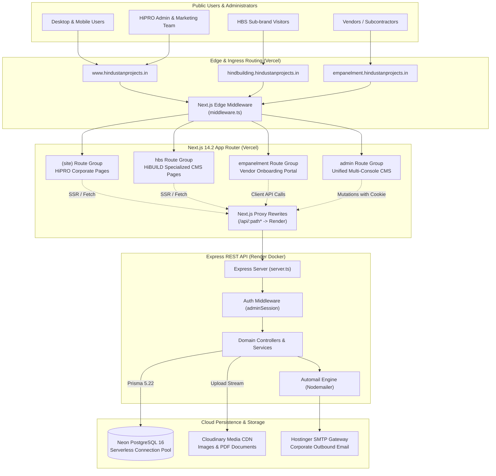
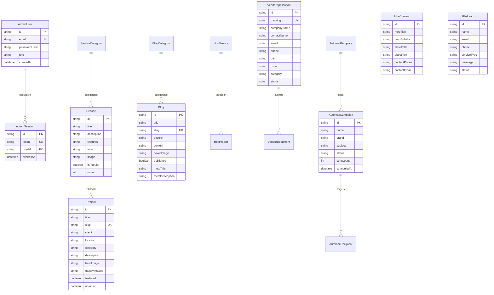
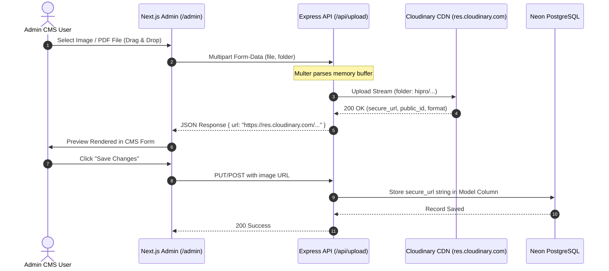
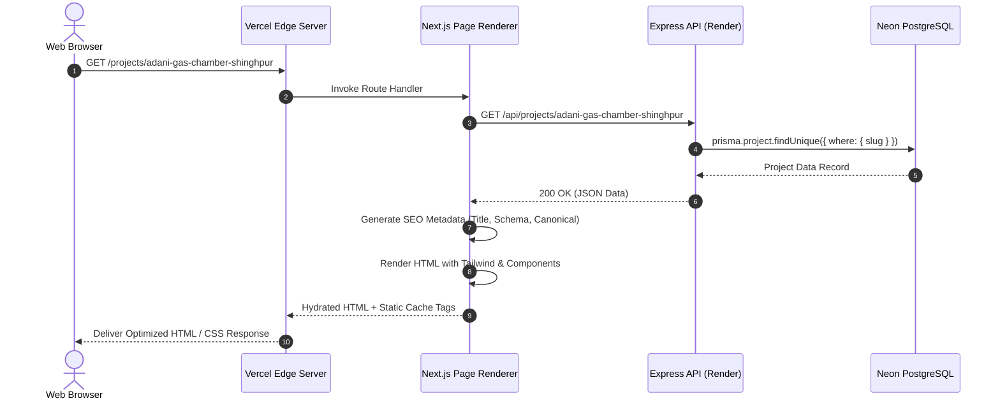
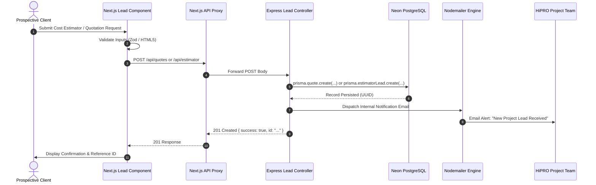

# HINDUSTAN PROJECTS (HiPRO) — ARCHITECTURE AND DATA FLOW
**Document Reference:** `DOC-HIPRO-AUDIT-002`  
**Audit Date:** October 2026 (Local System Time: 2026-10-21)  
**Status:** Complete Read-Only Technical Audit  
**Author/Auditor:** Antigravity AI Senior Technical Auditor  

---

## 1. High-Level Ecosystem Topology

The Hindustan Projects ecosystem is structured as a decoupled full-stack architecture featuring a Next.js 14 frontend, an Express/TypeScript REST API backend, a PostgreSQL relational database on Neon Serverless, and Cloudinary for media assets.



---

## 2. Frontend Application Architecture (Next.js 14.2)

### 2.1 Framework & Core Technologies
- **Framework:** Next.js 14.2.5 (App Router).
- **Runtime:** Node.js 18+ on Vercel Edge/Serverless functions.
- **Styling:** TailwindCSS 3.4.10, Tailwind Typography, Tailwind Animate, Framer Motion 11.3.28, Lucide React icons.
- **Typography:** Montserrat (Body & Display), Playfair Display (Luxury/Accent Headings), JetBrains Mono (Technical/Data figures).

### 2.2 Hostname Routing Middleware (`frontend/middleware.ts`)
The multi-domain ecosystem routes distinct hostnames to specific subtrees within the App Router:
- **`hindbuilding.hindustanprojects.in`** (or `hindbuilding.localhost:3000`): Rewrites the incoming request to `/hbs/*`.
- **`empanelment.hindustanprojects.in`** (or `empanelment.localhost:3000`): Rewrites the incoming request to `/empanelment/*`.
- **`www.hindustanprojects.in`** (and root domain): Renders default corporate routes from `frontend/app/(site)/*`.
- **Admin Access:** `/admin` and `/admin-login` remain accessible across hostnames or via the primary domain.

### 2.3 Route Tree Breakdown
```
frontend/app/
├── (site)/                  # Primary HiPRO Public Corporate Website
│   ├── page.tsx             # Homepage (Hero, Services, Projects, Stats, Testimonials, CTA)
│   ├── about/               # About Us, Vision, Philosophy, Leadership, Milestone timeline
│   ├── services/            # Services Grid Listing & Filter
│   │   └── [slug]/          # Service Detail (Scope, Process, Deliverables, FAQs, Related Projects)
│   ├── projects/            # Architectural & Construction Portfolio Showcase
│   │   └── [slug]/          # Project Detail (Specifications, Gallery, Impact, Scope)
│   ├── blogs/               # Industry Insights & Educational Articles
│   │   └── [slug]/          # Blog Post Reader & Category Filters
│   ├── cost-estimator/      # Multi-step Interactive Construction Estimator
│   ├── contact/             # Contact Form, Corporate Office Map, Inquiries
│   ├── quotations/          # Formal Project RFP & Quotation Submission Form
│   ├── why-us/              # Value Proposition & Engineering Excellence
│   ├── privacy-policy/      # Legal & Privacy Disclosures
│   └── terms/               # Terms of Service
├── hbs/                     # Hind Building Solutions (HiBUILD) Sub-brand Portal
│   ├── layout.tsx           # Distinct HBS Layout, Header, Red Theme & Navigation
│   ├── page.tsx             # HBS Homepage (Hero, Chemical Services, Projects, Testimonials)
│   ├── services/            # HBS Building Solutions Catalog
│   │   └── [id]/            # HBS Service Detail
│   ├── projects/            # Structural Repair & Waterproofing Case Studies
│   │   └── [id]/            # HBS Project Detail
│   ├── contact/             # HBS Technical Advisory & Consultation Request
│   └── privacy-policy/      # HBS Brand Disclosures
├── empanelment/             # Vendor & Contractor Empanelment Portal
│   ├── layout.tsx           # Empanelment Shell & Navigation
│   ├── page.tsx             # Portal Landing & Tier Requirements
│   ├── register/            # Multi-step Contractor Registration Form & Document Upload
│   ├── status/              # Registration Tracking & Application Lookup
│   └── vendor-terms/        # Vendor Agreement & Compliance Rules
├── admin/                   # Unified Multi-Console Admin CMS
│   ├── layout.tsx           # Admin Shell with PortalSwitcherDropdown.tsx
│   ├── page.tsx             # Master Dashboard & System Metrics
│   ├── services/            # HiPRO Services Management
│   ├── projects/            # HiPRO Projects Showcase Management
│   ├── blogs/               # Blog Publishing & SEO Metadata Management
│   ├── leads/               # Unified Inquiries, Quotes & Estimator Leads
│   ├── automail/            # Multi-Brand Email Campaign Automation Engine
│   ├── hbs/                 # Dedicated HiBUILD CMS Console
│   └── empanelment/         # Empanelment Applications & Document Review
└── admin-login/             # Secure Single-Page Admin Authentication
```

### 2.4 API Ingress Proxy (`frontend/next.config.mjs`)
To eliminate Cross-Origin Resource Sharing (CORS) complications and cookie blocking in modern browsers, Next.js rewrites incoming `/api/:path*` requests directly to the Render backend service:
```javascript
// frontend/next.config.mjs
async rewrites() {
  const backendUrl = process.env.NEXT_PUBLIC_API_URL || 'https://hipro-backend-749v.onrender.com';
  return [
    {
      source: '/api/:path*',
      destination: `${backendUrl}/api/:path*`,
    },
  ];
}
```

---

## 3. Backend Application Architecture (Express + TypeScript)

### 3.1 Framework & Server Configuration
- **Server:** Express 4.22.2 compiled with TypeScript 5.6 and executed with `tsx`.
- **Security Middlewares:** `helmet` for HTTP headers, `cors` for cross-origin origin filtering, `cookieParser` for session management, and `express-rate-limit` for DDoS/brute-force mitigation.
- **Port:** Configured via `PORT` environment variable (defaults to `5000` locally, assigned dynamically by Render in production).
- **Health Check Endpoint:** `GET /health` returns JSON status `{ status: "ok", timestamp: ... }`.

### 3.2 Authentication & Session Architecture
The backend uses a secure, database-backed HTTP-only cookie authentication scheme:
1. **Login Request (`POST /api/admin/login`):** Validates email and password using `crypto.scryptSync` password hashing.
2. **Session Creation:** Generates a secure session token stored in PostgreSQL `AdminSession` table (or fallback token if table is uninitialized) with a 24-hour expiration.
3. **Session Delivery:** Dispatches an HTTP-only, secure, `SameSite=Lax` cookie named `adminSession`.
4. **Authentication Middleware (`authMiddleware.ts`):** Validates `req.cookies.adminSession` against the active session in PostgreSQL before granting access to protected CMS routes.

### 3.3 API Route Registry & Controller Mapping
| Router Path | Handler File | Primary Operations | Auth Required |
| :--- | :--- | :--- | :---: |
| `/api/services` | `services.routes.ts` | List services, fetch service by slug, create, update, delete | Mutate only |
| `/api/projects` | `projects.routes.ts` | List projects, fetch project by slug, create, update, delete | Mutate only |
| `/api/blogs` | `blogs.routes.ts` | List published blogs, search, get blog by slug, CMS manage | Mutate only |
| `/api/about` | `about.routes.ts` | Get corporate about profile, update singleton records | Mutate only |
| `/api/hero` | `hero.routes.ts` | Get active homepage hero slides, create/update slides | Mutate only |
| `/api/estimator` | `estimator.routes.ts` | Ingest cost calculator leads, list leads for admin | Read leads only |
| `/api/contact` | `contact.routes.ts` | Ingest contact inquiries, admin lead management | Read leads only |
| `/api/quotes` | `quotes.routes.ts` | Ingest formal RFPs/quotations, admin review | Read leads only |
| `/api/testimonials`| `testimonials.routes.ts`| Fetch approved reviews, CMS management | Mutate only |
| `/api/faqs` | `faqs.routes.ts` | Fetch categorized FAQs, CMS management | Mutate only |
| `/api/team` | `team.routes.ts` | Fetch leadership profiles, CMS management | Mutate only |
| `/api/careers` | `careers.routes.ts` | Fetch job postings, submit resumes, CMS manage | Mutate only |
| `/api/hbs/*` | `hbs.routes.ts` | HBS content, services, projects, leads CMS | Mutate only |
| `/api/empanelment/*`| `empanelment.routes.ts`| Vendor applications, file uploads, approval status | Mutate only |
| `/api/automail/*` | `automail.routes.ts` | Campaign creation, template builder, email dispatch | Yes (All) |
| `/api/upload` | `upload.routes.ts` | Image and PDF document uploads via Cloudinary | Yes (All) |
| `/api/admin/*` | `admin.routes.ts` | Admin auth, session verification, user profile | Yes (Except login) |

---

## 4. Database Layer & Model Architecture (Prisma & Neon)

### 4.1 Database Specification
- **Engine:** PostgreSQL 16.
- **Hosting:** Neon Serverless PostgreSQL (`ep-rapid-salad-azar0h0l.c-3.ap-southeast-1.aws.neon.tech`).
- **ORM:** Prisma Client 5.22.0.
- **Connection Mode:** Pooled connection string with SSL enabled (`sslmode=require`).

### 4.2 Entity Relationship Diagram (ERD)



---

## 5. Media & Asset Pipeline



---

## 6. Detailed Data Flow Sequences

### 6.1 Public User Page Request (SSR / Cache Pipeline)


### 6.2 Customer Lead & Quotation Ingestion Flow


---

## 7. Security & Compliance Architecture

- **CORS Strategy:** Origin whitelist limited to `hindustanprojects.in`, `*.hindustanprojects.in`, and verified local development ports.
- **Rate Limiting:** `express-rate-limit` enforces strict request throttling on lead submission routes and login endpoints to block spam bots and brute-force attempts.
- **Environment Isolation:** Zero credentials or private keys hardcoded in version control; all credentials ingested via environment variables at runtime on Vercel and Render.
