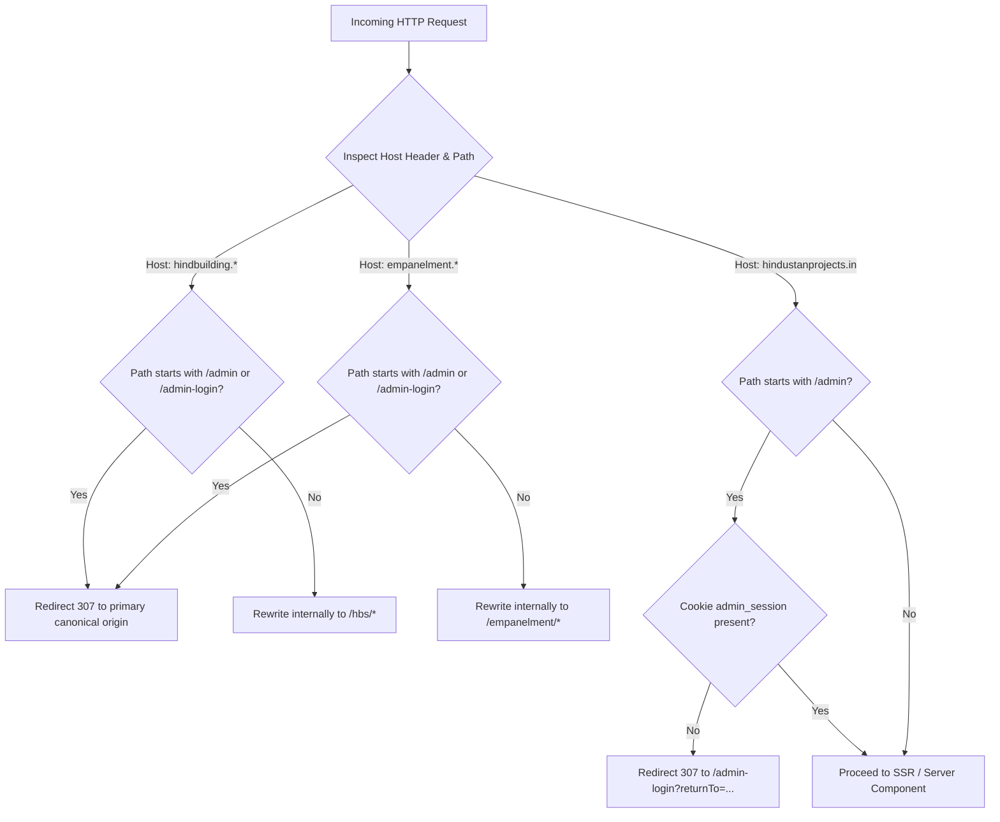

# Hindustan Projects (HiPRO) Ecosystem Master Report

---

## 1. Executive Architecture Overview

The **Hindustan Projects Ecosystem** is an integrated multi-brand platform engineered to support large-scale civil engineering, infrastructure development, specialized building repair, vendor procurement, and corporate administration.

The platform is designed around a monorepo structure housing a **Next.js 15 App Router** frontend and an **Express.js / TypeScript** backend, connected to a single relational **PostgreSQL** database managed through **Prisma ORM**.

```mermaid
graph TD
    subgraph "Client Layer (Vercel Frontend - Project hipro-web-r7y9)"
        ROUTER["Next.js Middleware<br/>(frontend/middleware.ts)"]
        HIPRO_UI["HiPRO Corporate Site<br/>(app/(site)/*)"]
        HBS_UI["HBS Sub-Brand Site<br/>(app/hbs/*)"]
        VENDOR_UI["Vendor Empanelment Portal<br/>(app/empanelment/*)"]
        ADMIN_UI["Master Admin Cockpit<br/>(app/admin/* & app/admin-login/*)"]
    end

    subgraph "Routing Decisions at Edge"
        ROUTER -->|host: hindustanprojects.in| HIPRO_UI
        ROUTER -->|host: hindbuilding.*| HBS_UI
        ROUTER -->|host: empanelment.*| VENDOR_UI
        ROUTER -->|path: /admin (primary domain only)| ADMIN_UI
    end

    subgraph "API & Service Layer (Render Backend - hipro-backend-749v)"
        API["Express API Server (backend/src/server.ts)"]
        AUTH_GUARD["Authentication & Sliding Sessions<br/>(authGuard.ts & lib/auth.ts)"]
        RBAC["RBAC Permission Engine<br/>(parseUserPermissions)"]
        AUTOMAIL["Automail Communications Engine<br/>(services/automail/emailSender.ts)"]
        UPLOAD["Cloudinary Media Gateway<br/>(routes/upload.ts)"]
    end

    subgraph "Database & Storage Layer"
        DB[(PostgreSQL Database<br/>Prisma ORM - 35 Models)]
        CLOUDINARY[("Cloudinary Asset Store<br/>(Bucket: fczoredh)")]
    end

    HIPRO_UI -->|SSR & Client Requests| API
    HBS_UI -->|SSR & Client Requests| API
    VENDOR_UI -->|SSR & Client Requests| API
    ADMIN_UI -->|Authenticated Requests| API
    API --> AUTH_GUARD --> RBAC --> DB
    API --> AUTOMAIL
    API --> UPLOAD --> CLOUDINARY
```

---

## 2. The Four Product Components & Relationships

### Component 1: Hindustan Projects (HiPRO)
- **Role:** Flagship corporate brand portal.
- **Audience:** Institutional clients, commercial developers, high-net-worth residential clients, and government infrastructure procurement bodies.
- **Core Capabilities:** Public showcase of multi-crore civil and architectural projects, detailed service specifications, interactive cost estimation engine, thought leadership insights, career openings, and verified guarantee policies.
- **Routing:** Served on the primary root domain (`hindustanprojects.in` / `www.hindustanprojects.in`).

### Component 2: Hind Building Solutions (HBS)
- **Role:** Specialized maintenance, waterproofing, and structural rehabilitation sub-brand.
- **Audience:** Facility managers, residential welfare associations (RWAs), industrial plant heads, and commercial property owners requiring urgent repairs.
- **Core Capabilities:** Waterproofing diagnostics, structural retrofitting, expansion joint treatments, customized repair BOQ PDF downloads, and warranty validation.
- **Routing:** Mapped to `hindbuilding.hindustanprojects.in` (rewritten internally to `/hbs`) or accessed via `hindustanprojects.in/hbs`.

### Component 3: Central Master Admin
- **Role:** Centralized command cockpit for all brands, applications, and modules.
- **Audience:** Internal executive leadership, system administrators, marketing editors, and operations managers.
- **Core Capabilities:** Role-Based Access Control (RBAC), sliding session token renewal, blogs CMS, project portfolio management, career application reviews, quote request processing, HBS service curation, and Automail template design.
- **Routing:** Restricted to the canonical primary domain at `/admin` and `/admin-login`. Subdomain access is explicitly blocked at the edge.

### Component 4: Vendor Portal (Empanelment & Procurement)
- **Role:** Procurement gateway for contractors, skilled trade vendors, and material suppliers.
- **Audience:** Civil subcontractors, material vendors, labor contractors, and equipment hire providers.
- **Core Capabilities:** CPWD capacity class registration (Class A through D), multi-step compliance data capture (GST, PAN, bank details), tender notices, bidding submissions, and on-site worker gate pass generation.
- **Routing:** Served on `empanelment.hindustanprojects.in` (and alias `vendor.hindustanprojects.in`), rewritten to `/empanelment`.

---

## 3. Subdomain Isolation & Edge Routing Architecture

The ecosystem leverages Next.js 15 Edge Middleware (`frontend/middleware.ts`) to achieve clean multi-tenant hostname routing from a single codebase while enforcing strict security boundaries:



### Key Security Safeguards in Middleware:
1. **Host Isolation:** Subdomains cannot access admin endpoints. If an attacker or user accesses `https://hindbuilding.hindustanprojects.in/admin`, the middleware returns an immediate 307 redirect to `https://www.hindustanprojects.in/admin`.
2. **Edge Authentication Interception:** Unauthenticated visitors to `/admin/*` are intercepted before SSR rendering and redirected to `/admin-login` with a sanitized `returnTo` parameter.
3. **Static & API Passthrough:** API requests (`/api/*`), Next.js runtime chunks (`/_next/*`), and asset files are passed through without modification.

---

## 4. Shared Infrastructure & Technical Dependencies

### 1. Database Tier (PostgreSQL & Prisma)
- **Engine:** PostgreSQL managed via Prisma ORM client (`backend/src/lib/db.ts`).
- **Models:** 35 data models defined in `backend/prisma/schema.prisma`.
- **Concurrency:** Connection pooling configured with query timeouts and prepared statements.

### 2. File & Asset Management (Cloudinary)
- **Integration:** Managed via `backend/src/routes/upload.ts` using the official Cloudinary Node.js SDK.
- **Default Cloud Name:** `fczoredh`.
- **Upload Profiles:** Project photography, team member portraits, vendor compliance documents, blog cover art, and site mockups.

### 3. Rate Limiting & Abuse Prevention
- Express rate limiters configured in `backend/src/middleware/rateLimiter.ts`:
  - `authLoginLimiter`: 5 login attempts per minute per IP.
  - `contactLimiter`: 5 submissions per minute per IP.
  - `quoteLimiter`: 5 quote requests per minute per IP.
  - `uploadLimiter`: 10 file uploads per minute per authenticated user.

### 4. Development Safety Boundaries (Phase 2C-1O Hardening)
- **Database Safety Guard (`backend/src/lib/databaseSafety.ts`):** Verifies that local development scripts and seeders execute strictly against loopback addresses (`localhost`, `127.0.0.1`), terminating execution if a remote database URL is detected.
- **Cloudinary Asset Isolation (`ALLOW_DEV_CLOUDINARY_UPLOADS=false`):** Intercepts local file uploads in dev mode, preventing modification of live production media.
- **Email Delivery Interception (`ENABLE_LIVE_EMAIL_IN_DEV=false`):** Blocks live SMTP delivery during local development, writing output safely to console/disk logs.
- **Production Seed Guard (`ALLOW_PRODUCTION_SEED=false`):** Prevents automated database seed scripts from overwriting live production data.

---

## 5. Current Overall Ecosystem Health & Verification Baseline

As of **Git commit `d88f36c34599a829a0a52404379d7f1b52e3ec1b` (PR #14 Merge Commit)**:
- **Build Status:** Next.js frontend builds cleanly; TypeScript backend compiles without errors (`tsc` passes).
- **Automated Test Coverage:** 272 automated test assertions across 5 suites:
  1. `test_admin_url_security.ts` (Admin route protection & redirect security).
  2. `test_rbac_authorization.ts` (Permission checks & fail-closed parsing).
  3. `test_sliding_session.ts` (Token renewal & 2-hour expiration).
  4. `batch1-code-fixes.test.mjs` (HiPRO public core, slug resolution, and HBS components).
  5. `local-safety.test.mjs` (Development safety guards and fail-closed proxies).
- **Workspace Health:** Canonical working directory `Hipro-Web` is clean and synchronized with `origin/main`.

