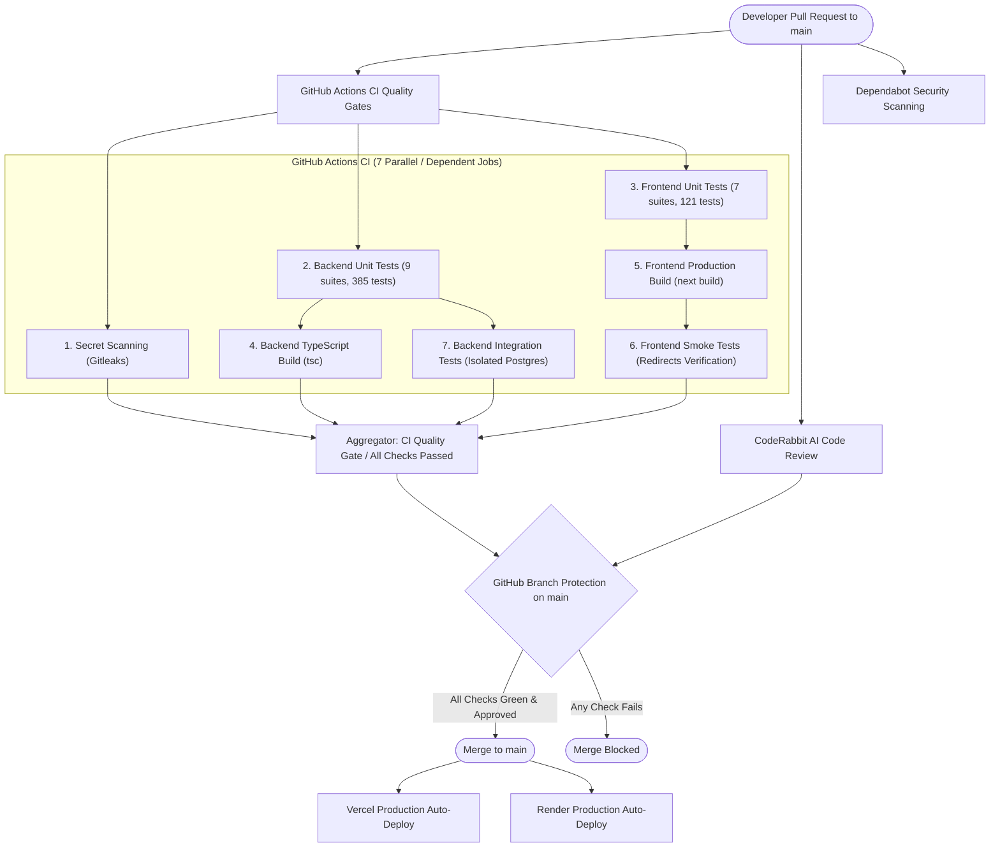

# Hindustan Projects — Git Automation Foundation Master Guide

## 1. Overview & Purpose
This document establishes the comprehensive automated continuous integration, code review, dependency scanning, branch protection, and production deployment gating architecture for the **Hindustan Projects Ecosystem** (`hindustan-groups/Hipro-Web`).

The primary purpose is to ensure that **no untested, insecure, or breaking code can ever reach the `main` branch or trigger a production deployment** on either Vercel or Render.

---

## 2. Infrastructure Architecture & Components



---

## 3. GitHub Actions CI Configuration (`.github/workflows/ci.yml`)

### A. Core Workflow Rules
- **Triggers:** Push to `main`, and Pull Request to `main`.
- **Concurrency:** `cancel-in-progress: true` automatically cancels stale runs on rapid pushes.
- **Least Privilege:** Global workflow permission strictly pinned to `permissions: contents: read`.
- **Action Pinning:** All GitHub Actions pinned to full 40-character commit SHAs.

### B. Summary of Jobs
| Job Key | Display Name | Purpose | Pre-requisite |
| :--- | :--- | :--- | :--- |
| `secret-scan` | `Secret Scanning (Gitleaks)` | Scans commits for API keys, passwords, and tokens using `.gitleaks.toml`. | None |
| `backend-unit-tests` | `Backend Unit Tests` | Executes all 9 backend test suites (safety, URL, automail, Cloudinary, CSV, headers, sessions, uploads, RBAC). | None |
| `frontend-unit-tests` | `Frontend Unit Tests` | Executes all 7 frontend test suites (projects CMS, site stats, analytics/PII, batch fixes, schema, slugs, local loopback safety). | None |
| `backend-build` | `Backend TypeScript Build` | Compiles backend TypeScript via `tsc`. | `backend-unit-tests` |
| `frontend-build` | `Frontend Production Build` | Executes `next build` with fail-closed production environment variables; archives `.next` artifact. | `frontend-unit-tests` |
| `frontend-smoke-tests` | `Frontend Smoke Tests (Redirects Verification)` | Tests live 308 redirect behavior against the production build output. | `frontend-build` |
| `backend-integration-tests` | `Backend Integration Tests (Isolated PostgreSQL Container)` | Spawns an ephemeral `postgres:16-alpine` service (`hipro_ci_test`) and executes integration suites. | `backend-unit-tests` |
| `ci-quality-gate` | `CI Quality Gate / All Checks Passed` | Aggregates all 7 job results and deterministically verifies complete success. | All 7 Jobs |

---

## 4. CodeRabbit AI Review Configuration (`.coderabbit.yaml`)

CodeRabbit automatically reviews incoming pull requests against the 4 Hindustan Projects sub-ecosystems:
- **HiPRO Public Frontend:** Validates zero-cropping image containment (`object-contain object-center`), Next.js Image configuration, responsive typography, and canonical URL structure.
- **HBS (Hindustan Building Solutions):** Enforces lead intake sanitization and loopback database safety.
- **Master Admin & RBAC:** Enforces `requirePermission` on all mutation routes, sliding session expiration, and CUID token validation.
- **Fail-Closed Environment Safety:** Blocks any code connecting to production databases during dev/test/staging.

*Note for Repositories with <10 Stars:* CodeRabbit requires explicit review invocation via PR comments (`@coderabbitai review`) or the GitHub PR review checkbox until the repository reaches 10 stars or an upgraded plan.

---

## 5. Automated Security Scanning (`.github/dependabot.yml`)

Dependabot runs scheduled weekly dependency vulnerability checks every Monday at 06:00 IST for:
1. `frontend` npm packages.
2. `backend` npm packages.
3. `.github/workflows` GitHub Actions dependencies.

---

## 6. Production Deployment Gating (Vercel & Render)

Both Vercel (`hipro-web-r7y9`) and Render (`hipro-backend-749v`) are configured to auto-deploy from the `main` branch. Neither platform natively gates commits prior to pushing to GitHub.

Therefore, **GitHub Branch Protection on `main` is the sole and authoritative production gatekeeper**. By preventing any pull request from merging without passing all CI checks, broken or insecure code is mathematically prevented from reaching production.

### Required GitHub Branch Protection Settings for `main`:
1. Navigate to: `GitHub Repository -> Settings -> Branches -> Add branch protection rule`.
2. Branch name pattern: `main`.
3. Check: **Require a pull request before merging**
   - Require approvals: Minimum 1.
   - Dismiss stale pull request approvals when new commits are pushed: Checked.
4. Check: **Require status checks to pass before merging**
   - Require branches to be up to date before merging: Checked.
   - Status checks to require:
     - `CI Quality Gate / All Checks Passed`
     - `Secret Scanning (Gitleaks)`
     - `Backend Unit Tests`
     - `Frontend Unit Tests`
     - `Backend TypeScript Build`
     - `Frontend Production Build`
     - `Frontend Smoke Tests (Redirects Verification)`
     - `Backend Integration Tests (Isolated PostgreSQL Container)`
5. Check: **Do not allow bypassing the above settings** (Enforce for administrators).
6. Check: **Restrict who can push to matching branches** (Only pull request merges permitted).

---

## 7. Local Developer Verification Commands

Before creating a pull request, developers should execute:

```powershell
# 1. Run all unit tests (Frontend + Backend)
npm run test:unit

# 2. Run backend TypeScript build
npm run build:backend

# 3. Run frontend TypeScript check & linter
npx tsc --noEmit --project frontend/tsconfig.json
npm run lint --prefix frontend

# 4. Run local integration tests (requires local PostgreSQL container 'hipro_ci_test')
npm run test:integration
```

