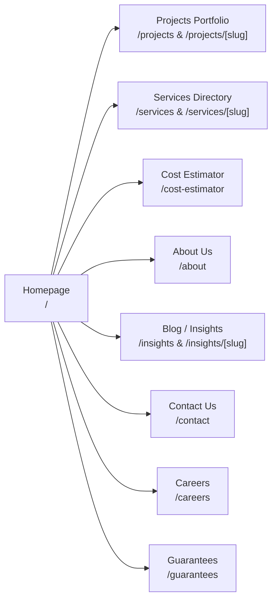

# Hindustan Projects (HiPRO) — Main Corporate Website Status

---

## 1. Component Overview

The **Hindustan Projects (HiPRO)** website is the flagship digital presence for Hindustan Projects, an infrastructure, architecture, interior design, and large-scale civil engineering firm operating across India.

- **Primary URL:** `https://www.hindustanprojects.in` (and `https://hindustanprojects.in`)
- **Hosting Tier:** Vercel (Project `hipro-web-r7y9`)
- **Route Group:** `frontend/app/(site)/`
- **Current Release Baseline:** Commit `d88f36c34599a829a0a52404379d7f1b52e3ec1b` (PR #14 Merge Commit)

---

## 2. Public Pages & User Workflows

### 1. Homepage (`app/(site)/page.tsx`)
- **Hero Showcase (`components/Hero.tsx`):** High-impact dynamic hero carousel highlighting flagship civil achievements, real-time KPI metrics (projects completed, square feet built, active sites), and primary call-to-action triggers.
- **Projects Carousel (`components/Projects.tsx` & `PublicProjectGrid.tsx`):** Grid layout with category filtering (Commercial, Residential, Industrial, Interior), responsive aspect ratio cards, and hover elevation states.
- **Client Testimonials:** Dynamic client feedback cards loaded via `/api/testimonials`.
- **Pre-Footer Lead Capture:** Contact triggers dispatching directly to the CRM leads database.

### 2. Projects Portfolio (`app/(site)/projects/page.tsx` & `app/(site)/projects/[slug]/page.tsx`)
- **Canonical Slug Resolution:** Projects are queried by URL-safe slugs (e.g. `/projects/omaxe-mall-renovation`).
- **Legacy ID Redirect Fallback (`frontend/lib/projectUrl.ts`):** Automatically detects incoming numeric or legacy UUID queries and executes an HTTP 301/308 permanent redirect to the canonical slug format to preserve inbound backlinks.
- **Curated Catalog (`frontend/lib/curatedProjects.ts`):** Hardened offline fallback catalog ensuring the project grid renders gracefully even if the backend database connection encounters network latency.
- **Project Detail Metadata:** Scope of work, client name, construction timeline, architectural specifications, and Cloudinary gallery photography.

### 3. Services Directory (`app/(site)/services/page.tsx` & `app/(site)/services/[slug]/page.tsx`)
- Covers comprehensive civil capabilities: Turnkey Civil Construction, Architectural Planning, Structural Retrofitting, Corporate Interior Fitouts, MEP Engineering, and Project Management Consultancy (PMC).
- Individual service breakdown pages detail methodologies, quality assurance protocols, compliance standards, and related project callouts.

### 4. Interactive Cost Estimator (`app/(site)/cost-estimator/page.tsx`)
- **Dynamic Civil Calculator:** Allows clients to calculate estimated construction budgets based on plot area, structure type (RCC, Steel, Composite), quality tiers (Standard, Premium, Luxury), and interior finishes.
- **Instant BOQ Dispatch:** Integrates with backend lead ingestion (`backend/src/routes/quote.ts`), generating a customized inquiry record and sending a confirmation email via the Automail engine.

### 5. Dynamic About Us Page (`app/(site)/about/page.tsx`)
- **Hybrid SSR Architecture:** Renders dynamic data from the `AboutPageContent` singleton model in the database, with robust fallback to verified static corporate history.
- **Content Sections:** Corporate narrative, founder vision, leadership team gallery (`TeamMember` model), core engineering values, and verified safety certifications.

### 6. Thought Leadership / Insights (`app/(site)/insights/page.tsx`)
- **Blog Engine:** Technical articles and market insights stored in the `BlogPost` model.
- **Rendering:** Responsive typography, markdown body parsing, reading time estimates, author attribution, and tag-based categorization.

### 7. Lead Forms & Contact Inquiries (`app/(site)/contact/page.tsx` & `components/PopupForm.tsx`)
- Ingests direct customer inquiries into the `ContactMessage` table.
- Protected by Express rate limiting (`contactLimiter` at 5 requests/minute).
- Dispatches automated confirmation emails to users and notification alerts to staff.

---

## 3. CMS & Admin Capabilities for HiPRO

Master Admin provides dedicated editing studios for every aspect of the HiPRO website:

| Admin Studio Route | Managed Entity | Database Model | Backend Route |
| :--- | :--- | :--- | :--- |
| `/admin/projects` | Project Portfolio | `Project` | `backend/src/routes/projects.ts` |
| `/admin/services` | Core Services | `Service` | `backend/src/routes/services.ts` |
| `/admin/blogs` | Insights & Articles | `BlogPost` | `backend/src/routes/blogs.ts` |
| `/admin/hero` | Homepage Slider | `HeroSlide` | `backend/src/routes/hero.ts` |
| `/admin/testimonials`| Client Reviews | `Testimonial` | `backend/src/routes/testimonials.ts` |
| `/admin/about` | Corporate About CMS | `AboutPageContent` | `backend/src/routes/about.ts` |
| `/admin/team` | Leadership Team | `TeamMember` | `backend/src/routes/team.ts` |
| `/admin/stats` | KPI Metric Badges | `Stats` | `backend/src/routes/stats.ts` |
| `/admin/leads` | Inquiries & CRM | `ContactMessage` | `backend/src/routes/leads.ts` |
| `/admin/quote` | Cost Estimator Quotes | `QuoteRequest` | `backend/src/routes/quote.ts` |
| `/admin/applications`| Job Applications | `JobApplication` | `backend/src/routes/applications.ts` |

---

## 4. SEO, AEO, and GEO Implementation

The HiPRO website implements modern Search Engine, Answer Engine (AEO), and Generative Engine Optimization (GEO) standards:

1. **OpenGraph Banner:** High-resolution branded social card (`frontend/public/og-banner.jpg` committed in PR 1) linked in root metadata (`frontend/app/layout.tsx`).
2. **Dynamic XML Sitemap (`frontend/app/sitemap.ts`):** Programmatically queries all published project slugs, service slugs, and blog articles from the database, generating fully qualified XML sitemaps with `lastModified`, `changeFrequency`, and priority attributes.
3. **Structured Data (JSON-LD):** Emits schema.org microdata for:
   - `Organization`: Corporate name, CIN, official logo, social links, registered address.
   - `WebSite`: SearchAction schema for site search.
   - `RealEstateProject` / `ConstructionBusiness`: Project locations, geotechnical specs.
   - `BlogPosting`: Headline, author, datePublished, image, publisher.
4. **Canonical URL Normalization:** All URLs are forced to lowercase, trailing slashes are unified, and non-canonical Render hosts are auto-healed to the production domain.

---

## 5. Completed Work

- **PR 1 Integration (`abfc3f7`):** Public projects hero overhaul, SEO OpenGraph banner integration, accessible popup modal forms, project category filters, and curated offline fallbacks.
- **P0 Slug Sanitization (`d596605`):** Elimination of numeric ID routing in favor of URL-safe slugs with 301 redirect fallbacks.
- **Responsive Navigation Polish (`67c1acd`, `bdbff3f`):** Removal of redundant floating back buttons, fluid typography for mobile viewports, and navbar collision prevention.
- **Local Dev Safety Boundaries (`18dccf0`):** Loopback database assertions and fail-closed Next.js backend URL resolver.

---

## 6. Known Pending Work and Gaps

1. **Blog CMS Real-Time Auto-Save:**
   - The auto-save to browser `localStorage` and `beforeunload` warning handler resides in branch `fix/blog-cms-draft-content-integrity` (`095fd67`) and is not yet merged into `main`.
2. **Client-Side Form Field Validation:**
   - Cost estimator and quote modal forms rely on basic HTML5 constraints; adding inline Zod validation schemas would improve conversion and user feedback.
3. **Cloudinary WebP/AVIF Transcoding:**
   - Some legacy project uploads still use raw JPEG/PNG assets; implementing auto-format transformation parameters (`f_auto,q_auto`) across all image tags will improve Core Web Vitals.

