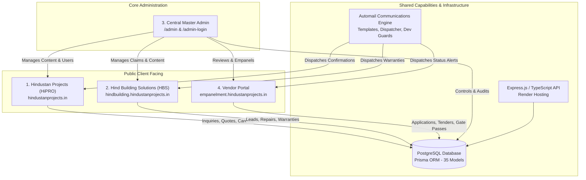

# Hindustan Projects (HiPRO) Ecosystem Documentation

Welcome to the comprehensive, evidence-backed technical documentation for the **Hindustan Projects Ecosystem**.

This documentation reflects the actual implementation, architecture, database schemas, API routes, security controls, and release history of the canonical codebase.

---

## Verified Repository Baseline

| Parameter | Current Value |
| :--- | :--- |
| **Canonical Repository Root** | `D:\HindustanProjects\Hipro-Website\Hipro-Web` |
| **Primary Production Worktree** | `D:\HindustanProjects\Hipro-Website\Hipro-Main` |
| **Active Checked-Out Branch** | `main` |
| **Current Canonical HEAD** | `d88f36c34599a829a0a52404379d7f1b52e3ec1b` |
| **Latest Merged Release** | **Pull Request #14** (PR 1–4 Combined Integration Stack) |
| **Remote Origin** | `https://github.com/hindustan-groups/Hipro-Web` |

---

## Ecosystem Scope

The Hindustan Projects ecosystem consists strictly of **four product components** sharing unified backend infrastructure, database models, and communication services:

1. **[Hindustan Projects (HiPRO)](./HIPRO_PROJECT_STATUS.md):** Main corporate engineering, construction, architecture, and interior infrastructure portal.
2. **[Hind Building Solutions (HBS)](./HBS_PROJECT_STATUS.md):** Specialized repair, waterproofing, rehabilitation, and facility maintenance sub-brand.
3. **[Central Master Admin](./MASTER_ADMIN_STATUS.md):** Unified administration cockpit, sliding session authentication, RBAC authorization, CMS studios, and CRM operations.
4. **[Vendor Portal](./VENDOR_PORTAL_STATUS.md):** Contractor and supplier onboarding, CPWD capacity tiering, tenders, and site gate passes.

*Note on Capabilities:*
- **[Automail System](./AUTOMAIL_SYSTEM.md)** is a cross-cutting communications engine utilized across all four components, not a separate standalone project.
- **Employee Portal** is a planned future sub-module of Master Admin, not a fifth independent project.

---

## Documentation Index

The documentation suite is structured into 12 detailed reference files:

| Document | Primary Focus & Coverage |
| :--- | :--- |
| **[1. ECOSYSTEM_MASTER_REPORT.md](./ECOSYSTEM_MASTER_REPORT.md)** | Overall system architecture, monorepo layout, subdomain routing, and cross-cutting layers. |
| **[2. HIPRO_PROJECT_STATUS.md](./HIPRO_PROJECT_STATUS.md)** | Corporate website status, public pages, dynamic slug routing, SEO/AEO/GEO, and lead capture. |
| **[3. HBS_PROJECT_STATUS.md](./HBS_PROJECT_STATUS.md)** | HBS sub-brand status, service breakdowns, claims remediation, BOQ generator, and CMS. |
| **[4. MASTER_ADMIN_STATUS.md](./MASTER_ADMIN_STATUS.md)** | Central admin cockpit, sliding session security, RBAC roles & permissions, and CMS studios. |
| **[5. VENDOR_PORTAL_STATUS.md](./VENDOR_PORTAL_STATUS.md)** | Vendor onboarding, empanelment workflows, CPWD tiers, bidding, and PII protection. |
| **[6. AUTOMAIL_SYSTEM.md](./AUTOMAIL_SYSTEM.md)** | Transactional email dispatcher, corporate branding wrappers, templates, and dev safety guards. |
| **[7. DATABASE_AND_API_REFERENCE.md](./DATABASE_AND_API_REFERENCE.md)** | Complete Prisma schema inventory (35 models), foreign key relationships, and 24 Express route files. |
| **[8. DEPLOYMENT_AND_ENVIRONMENT_GUIDE.md](./DEPLOYMENT_AND_ENVIRONMENT_GUIDE.md)** | Vercel & Render topology, domain DNS mappings, local development setup, and env variable reference. |
| **[9. GIT_AND_RELEASE_HISTORY.md](./GIT_AND_RELEASE_HISTORY.md)** | Monorepo worktrees, PR 1–4 commit ancestry, 4 preserved stashes, and release protocol. |
| **[10. KNOWN_ISSUES_AND_PENDING_WORK.md](./KNOWN_ISSUES_AND_PENDING_WORK.md)** | Evidence-backed defect inventory, technical debt items, and confirmed missing implementations. |
| **[11. DECISIONS_AND_OPEN_QUESTIONS.md](./DECISIONS_AND_OPEN_QUESTIONS.md)** | Architectural Decision Records (ADRs), historical choices, and unresolved items requiring user input. |

---

## Technical Stack Summary

- **Frontend:** Next.js 15 (App Router), React 18, Tailwind CSS, TypeScript.
- **Backend:** Node.js, Express.js, TypeScript, Prisma ORM, Nodemailer, Cloudinary SDK.
- **Database:** PostgreSQL (Hosted on cloud instance; loopback enforced for dev safety).
- **Hosting & Infrastructure:**
  - Frontend: Vercel (Project `hipro-web-r7y9` with production custom domains).
  - Backend: Render (`hipro-backend-749v.onrender.com`).
  - Storage: Cloudinary (Cloud name `fczoredh` with dev mutation isolation).

